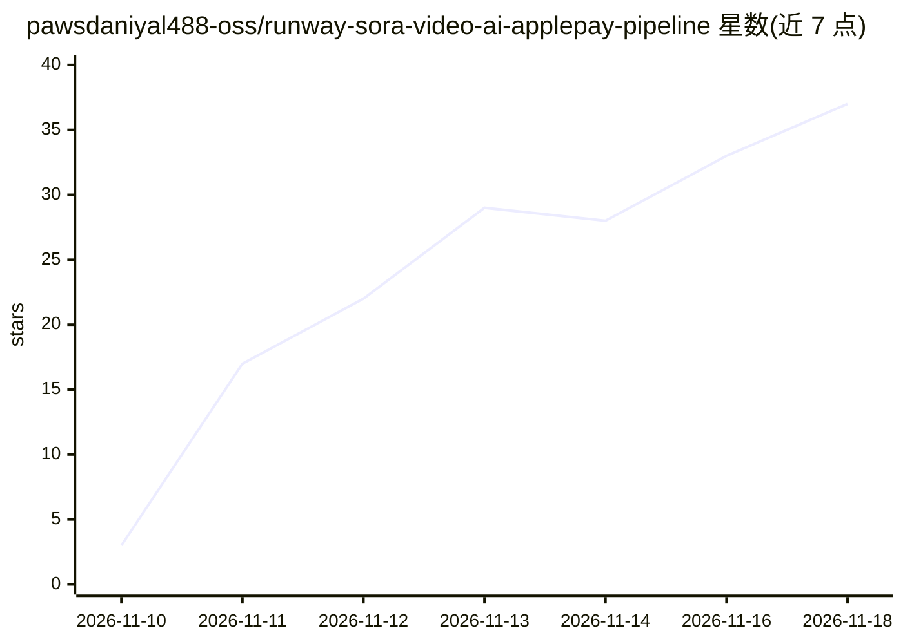

# pawsdaniyal488-oss/runway-sora-video-ai-applepay-pipeline

⭐ 37 · 推送 2026-11-10 · [GitHub](https://github.com/pawsdaniyal488-oss/runway-sora-video-ai-applepay-pipeline) · [官网](https://app.coregold.io/signup?invite_code=ADvlj9b) · 个人维护 · 中文 README

**教程：用 CoreGold 虚拟卡经 Apple Pay 订阅 Runway/Sora**

一篇图文教程（非软件项目）：指导读者在 CoreGold 平台注册并经 USDT（TRC-20/ERC-20）充值，开通标注支持 Apple Pay/Google Pay 的商业 Visa/Mastercard 虚拟卡，将其添加至 Apple Wallet 后用于支付 Runway、Sora 等视频生成平台的高阶订阅。内容含对比表、三步操作流程（充值→开卡→挂载支付）及账号矩阵、限额设置的说明。README 末尾含注册链接与一串哈希样式字符串，属推广性内容，无代码或可安装产物。

## 筛选速览

| 维度 | 判定 | 备注 |
|---|---|---|
| AI 角色 | `ai-knowledge` | 知识聚合/清单类 |
| 许可风险 | `none` | — |
| 部署形态 | `None` |  |
| 模型依赖 | — | README 未给出锁定关系 |
| 硬件要求 | — | 无带数字的原话,不猜 |
| 安装摩擦 | `low` | 无编译、无系统依赖或容器化 |
| 成熟度 | — | 结构信号不足 |

## 能力要点

- USDT 链上充值并按实时汇率折算为 USD 资金池的流程说明
- 生成支持 Apple Pay/Google Pay 的商业虚拟卡并配置单卡限额
- 将系统地区调整为美国后在 Wallet 中添加虚拟卡并完成支付的步骤

## 适用场景

- 了解用虚拟卡经 Apple Pay 为海外视频生成平台付费的操作流程
- 多账号场景下按一卡一号方式管理支付

## 场景标签

 · 领域:跨境支付/教程

## 证据(README 行号)

> L2: ⚡ 2026 实战指南：手把手教你用 CoreGold 商业 VCC 挂载 Apple Pay 秒级拿下 Runway / Sora
> L31: ## ⚡ 3 分钟极速部署实操教学
> L56: 👉 **点击注册并进入 CoreGold 官方发卡后台**

## 星数曲线

2026-11-10 3 → 2026-11-18 37（+34）

---
*卡片 v1 · prompt 1.4 · 生成 2026-11-18 · 置信度 mid · 依据 README sha `daeb0b7ddf11` · [字段定义](../../DATASET.md)*
