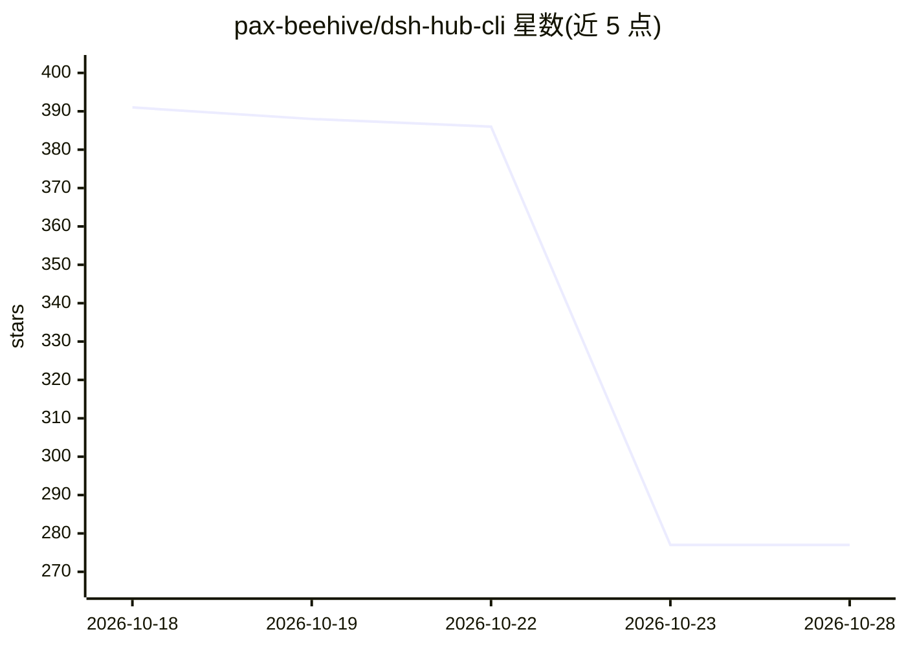

# pax-beehive/dsh-hub-cli

⭐ 277 · TypeScript · MIT · 推送 2026-10-20 · [GitHub](https://github.com/pax-beehive/dsh-hub-cli) · [官网](https://dshpluginhub.ai) · 组织维护 · 中文 README

**DeepSeek Harness 插件的版本化分享与安装 CLI（Preset/Profile 管理）**

DSH Plugin Hub 的开源客户端，面向 DeepSeek Harness（DSH）插件生态：把本地的插件集合、加载顺序、运行时版本与 cordis.patch.yml 配置捕获为内容寻址、带 sha256 哈希的不可变 Preset Release，团队成员可用一条命令精确复现同一套环境。提供搜索、安装、计划/应用（plan/apply）、diff、doctor、升级与回滚等命令，含 DSH agent 工具包（变更操作仅生成计划，需人工确认后执行）。密钥仅以环境变量引用发布。需 Node.js 22.13+；README 注明依赖锁分发与端到端校验等事项尚未完成。

## 筛选速览

| 维度 | 判定 | 备注 |
|---|---|---|
| AI 角色 | `ai-ecosystem` | LLM/agent 周边工具 |
| 许可风险 | `permissive` | MIT |
| 部署形态 | `library` | 以包/库形式分发 |
| 模型依赖 | — | README 未给出锁定关系 |
| 硬件要求 | — | 无带数字的原话,不猜 |
| 安装摩擦 | `low` | 无编译、无系统依赖或容器化 |
| 成熟度 | `idea` | |

## 能力要点

- Preset Release 内容寻址（sha256），CLI 应用前校验哈希
- plan/apply 流程：AI agent 只能创建计划，人工确认后方可执行
- 分阶段原子应用与保留完整修订的回滚机制
- 发布时拒绝含凭据样式的补丁，密钥仅以 ${ENV_VAR} 引用形式发布

## 适用场景

- 把团队共用的 DSH 插件组合与配置发布成可复现的版本化 Preset
- 一条命令应用同事的 Preset 并在升级前 diff 审查变更
- 让 AI agent 通过 agent tools 安全地规划并管理 DSH 插件配置

## 场景标签

 · 领域:AI agent 基础设施/包管理

## 证据(README 行号)

> L7: **Share your DeepSeek Harness plugins and configuration as a versioned Profile.**
> L153:     C --> P["<b>dsh-plugin</b> agent tools that call the CLI"]
> L209: Read-only tools (`dsh_hub_search`, `dsh_hub_profile_diff`, `dsh_hub_profile_doctor`, …) run freely. Mutating tools

## 星数曲线

2026-10-18 391 → 2026-10-28 277（-114）

---
*卡片 v1 · prompt 1.4 · 生成 2026-10-21 · 置信度 high · 依据 README sha `a0e47090970d` · [字段定义](../../DATASET.md)*
