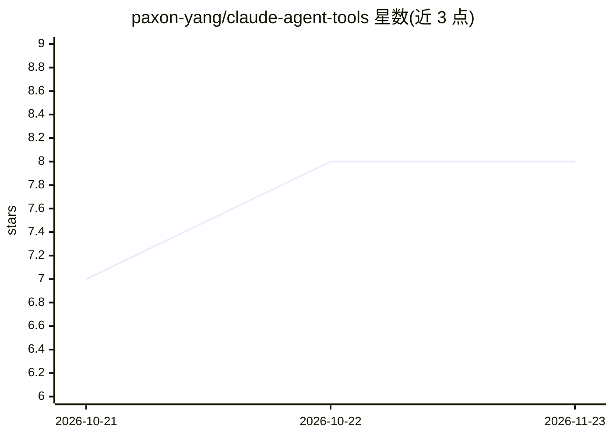

# paxon-yang/claude-agent-tools

⭐ 8 · JavaScript · MIT · 推送 2026-10-24 · [GitHub](https://github.com/paxon-yang/claude-agent-tools) · [官网](https://paxon-yang.github.io/claude-agent-tools/) · 个人维护 · 中文 README

**Claude Code 的自动模型路由插件与实时 agent 仪表盘**

为 Claude Code 提供两个工具：auto-router 插件在每轮对话及每个子 agent 上自动选择模型与 effort（简单查询走 Haiku、日常编码走 Sonnet、架构与多步任务走 Opus），并基于本地 transcript 生成相对全 Opus 基线的节省报告；agent-viz 在 localhost:4321 提供本地仪表盘，展示会话树、各子 agent 模型、成本估计与审批提醒。要求 Claude Code 2.1.288+ 与 Node.js 18+，通过 git clone 脚本安装，支持中英文界面、远程访问与手机端卡片。

## 筛选速览

| 维度 | 判定 | 备注 |
|---|---|---|
| AI 角色 | `ai-ecosystem` | LLM/agent 周边工具 |
| 许可风险 | `permissive` | MIT |
| 部署形态 | `None` |  |
| 模型依赖 | locked-api |  |
| 硬件要求 | — | 无带数字的原话,不猜 |
| 安装摩擦 | `low` | 无编译、无系统依赖或容器化 |
| 成熟度 | — | 结构信号不足 |

## 能力要点

- 每轮及每个子 agent 的自动模型路由，支持 #opus/#sonnet/#haiku 标签与 /route 固定
- 缓存感知降级：仅在缓存收益能覆盖时切换模型
- 质量门：便宜模型改码后在回合结束前自动运行测试，失败则升级模型
- 本地仪表盘与手机端卡片：会话树、模型时间线、成本与节省估计

## 适用场景

- 使用 Claude Code 时按任务难度自动分配模型以控制成本
- 多子 agent 会话中实时查看谁在做什么、用了哪个模型
- 追踪本地 transcript 生成按模型的开销与节省报告

## 场景标签

`模型网关` `LLM 可观测性` · 领域:Agent 开发

## 证据(README 行号)

> L3: **Automatic model routing and a live agent dashboard for Claude Code.**
> L29: |**auto-router**|A Claude Code plugin that picks the model and effort **every turn**, and for every sub-agent. Simp
> L30: |**agent-viz**|A local dashboard at `http://localhost:4321`: every project, the current task, a live tree of the ma

## 星数曲线

2026-10-21 7 → 2026-11-23 8（+1）

---
*卡片 v1 · prompt 1.4 · 生成 2026-11-20 · 置信度 high · 依据 README sha `168355859c2b` · [字段定义](../../DATASET.md)*
