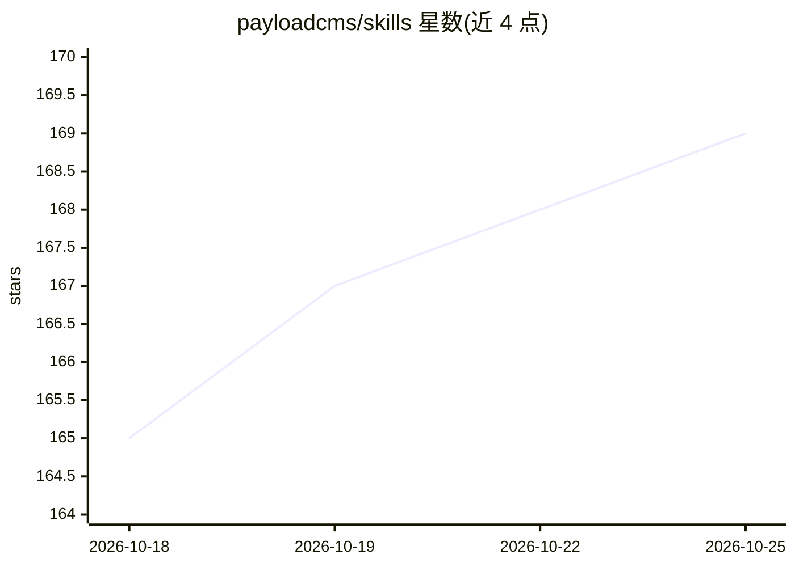

# payloadcms/skills

⭐ 169 · 推送 2026-08-10 · [GitHub](https://github.com/payloadcms/skills) · 组织维护

**面向 AI 编码 agent 的 Payload CMS 开发技能包**

Payload 官方维护的 AI agent 技能集合：以打包的指令与脚本形式扩展 AI 编码 agent 能力。包含两个技能：payload 技能提供 Payload 项目开发指南，覆盖 collections、字段、hooks、访问控制、查询（Local API/REST/GraphQL）、数据库适配器与插件开发的 TypeScript 模式；cms-migration 技能提供从 WordPress、Contentful、Strapi 等 CMS 数据源通过对话式流程设计 Payload collections 的迁移工作流。通过 npx skills add 命令安装，MIT 许可。

## 筛选速览

| 维度 | 判定 | 备注 |
|---|---|---|
| AI 角色 | `ai-ecosystem` | LLM/agent 周边工具 |
| 许可风险 | `none` | — |
| 部署形态 | `library` | 以包/库形式分发 |
| 模型依赖 | — | README 未给出锁定关系 |
| 硬件要求 | — | 无带数字的原话,不猜 |
| 安装摩擦 | `low` | 无编译、无系统依赖或容器化 |
| 成熟度 | — | 结构信号不足 |

## 能力要点

- payload 技能覆盖 collections/字段/hooks/访问控制/查询/插件开发指南
- cms-migration 技能支持从 WordPress、Contentful、Strapi 等 CMS 的数据映射迁移
- npx skills add 一条命令安装

## 适用场景

- AI 编码 agent 开发 Payload 项目时注入领域知识
- 从旧 CMS 迁移内容到 Payload 时生成 collection 配置

## 场景标签

`提示工程` · 领域:Agent 开发

## 证据(README 行号)

> L3: A collection of skills for AI coding agents. Skills are packaged instructions and scripts that extend agent capabili
> L8: npx skills add payloadcms/skills

## 星数曲线

2026-10-18 165 → 2026-10-25 169（+4）

---
*卡片 v1 · prompt 1.4 · 生成 2026-10-22 · 置信度 high · 依据 README sha `471989de2db6` · [字段定义](../../DATASET.md)*
