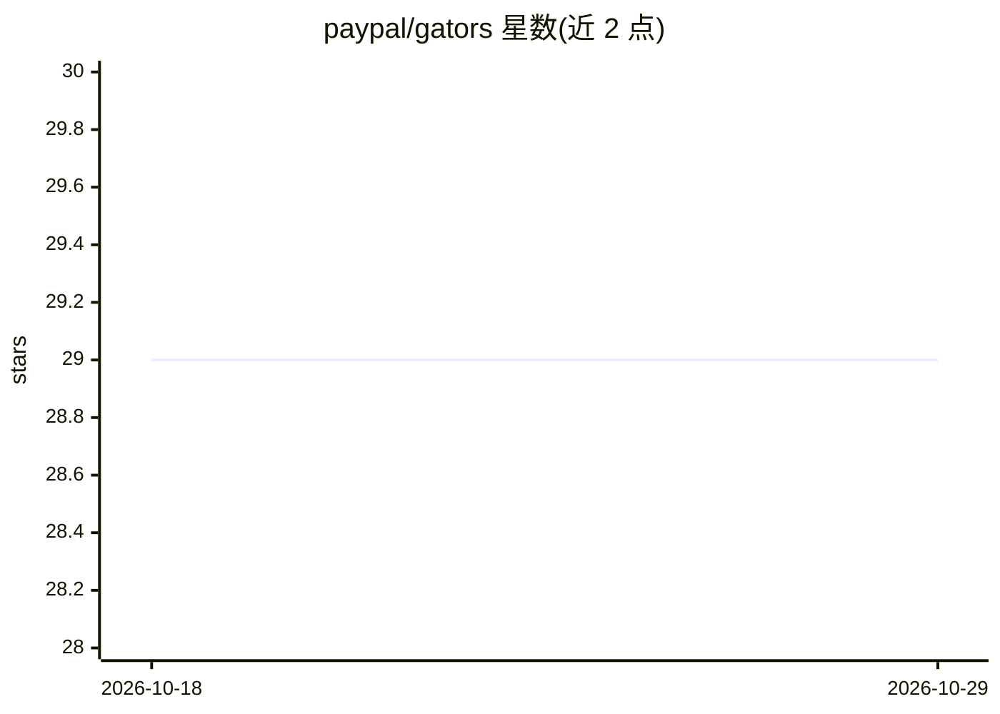

# paypal/gators

⭐ 29 · Python · Apache-2.0 · 推送 2026-09-22 · [GitHub](https://github.com/paypal/gators) · [官网](https://paypal.github.io/gators/) · 组织维护

**给数据科学家的 Polars 预处理与特征工程库，108 个转换器**

PayPal PSP Data Team 开发的 Python 数据预处理与特征工程库，基于 Polars 构建。提供 108 个 sklearn 风格转换器，覆盖数据清洗、缺失值填充、类别编码、离散化、缩放、特征生成与选择等 11 类，支持 Pipeline 链式调用，可导出 ONNX 图用于低延迟推理（少数字符串类转换器因 ONNX 字符串算子限制不可导出）。README 含与 scikit-learn、feature-engine 的基准对比（50 万行合成数据集）。需 Python 3.10+。

## 筛选速览

| 维度 | 判定 | 备注 |
|---|---|---|
| AI 角色 | `ai-ecosystem` | LLM/agent 周边工具 |
| 许可风险 | `permissive` | Apache-2.0 |
| 部署形态 | `library` | 以包/库形式分发 |
| 模型依赖 | — | README 未给出锁定关系 |
| 硬件要求 | — | 无带数字的原话,不猜 |
| 安装摩擦 | `low` | 无编译、无系统依赖或容器化 |
| 成熟度 | — | 结构信号不足 |

## 能力要点

- 108 个 sklearn 风格转换器，分 11 类（清洗/编码/缩放/离散化/特征选择等）
- Pipeline 链式组合并可导出 ONNX，附兼容性审计函数
- 覆盖数值/字符串/日期时间三类特征生成
- 基于 Polars，提供 pip 安装与源码安装

## 适用场景

- 在建模前完成缺失值填充、编码与特征构造
- 风控/反欺诈场景构建大规模特征工程管线
- 将预处理管线导出 ONNX 部署到生产推理环境

## 场景标签

 · 领域:机器学习工具库

## 证据(README 行号)

> L18: Gators is a library built on top of Polars, designed to streamline your entire ML workflow from raw data to product
> L25: - **🔄 Unified API**: Consistent sklearn-style `.fit()` and `.transform()` interface
> L27: - **🎯 Comprehensive**: 108 preprocessing transformers across 11 categories

## 星数曲线

2026-10-18 29 → 2026-10-29 29（+0）

---
*卡片 v1 · prompt 1.4 · 生成 2026-10-26 · 置信度 high · 依据 README sha `7d058b3f8597` · [字段定义](../../DATASET.md)*
