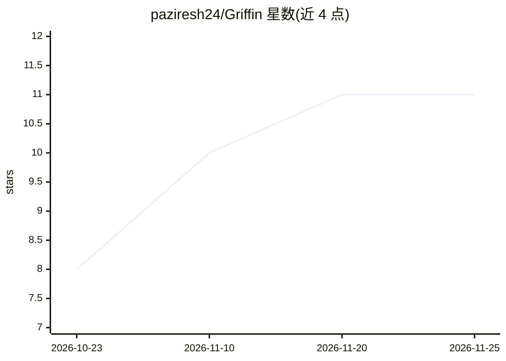

# paziresh24/Griffin

⭐ 11 · JavaScript · MIT · 推送 2026-11-23 · [GitHub](https://github.com/paziresh24/Griffin) · [官网](https://griffin.paziresh24.com/) · 组织维护

**自托管 AI agent 团队平台：定义 agent、工具权限与委托**

自托管平台，用户定义多个 AI agent——每个 agent 绑定工具与按调用者划分的工具配额，agent 之间可委托任务。运行于 Node 24 与 SQLite，无 SaaS 控制面。引擎可选 Claude 订阅 token、Anthropic API key、OpenAI、OpenRouter、本地 Ollama、Cursor 或任何 OpenAI 兼容端点；接入 Telegram/Bale 机器人、定时任务，并可作为 MCP server 供 Claude Code 等客户端调用。提供健康自检与自动修复、模拟聊天预演、CLI/Web/MCP 多种接口，UI 支持英文与波斯语。

## 筛选速览

| 维度 | 判定 | 备注 |
|---|---|---|
| AI 角色 | `ai-ecosystem` | LLM/agent 周边工具 |
| 许可风险 | `permissive` | MIT |
| 部署形态 | `self-host` | docker 或自建部署 |
| 模型依赖 | local-ok | 支持本地模型 |
| 硬件要求 | — | 无带数字的原话,不猜 |
| 安装摩擦 | `low` | 无编译、无系统依赖或容器化 |
| 成熟度 | — | 结构信号不足 |

## 能力要点

- agent 以表格行定义，工具配额在代码层按调用者过滤
- broker 进程持有凭据并仅暴露带 schema 的类型化工具，运行模型的进程无凭据无 shell
- 支持 Telegram/Bale、定时任务、MCP server、终端客户端与 HTTP API
- 健康检查每 15 分钟自修复：引擎失效时 agent 迁移到可用引擎

## 适用场景

- 在 Telegram 上搭建个人 AI 助手
- 作为 Claude Code 的 MCP 后端接任务
- 让同事通过消息与助理协作处理事务
- 把运维工具包接入 agent 管理自有系统

## 场景标签

`多智能体` `AI 助手` · 领域:Agent 开发

## 证据(README 行号)

> L9: **A self-hosted shell for a small team of AI agents that work for you.** You make the agents — what
> L104: Agents are rows in a table, not code. Quotas are enforced where tools are handed to the model, so a
> L151: Griffin is also an MCP server: Claude Code, Claude Desktop, Cursor or any other MCP client can hand

## 星数曲线

2026-10-23 8 → 2026-11-25 11（+3）

---
*卡片 v1 · prompt 1.4 · 生成 2026-11-19 · 置信度 mid · 依据 README sha `a75b05af9e9b` · [字段定义](../../DATASET.md)*
