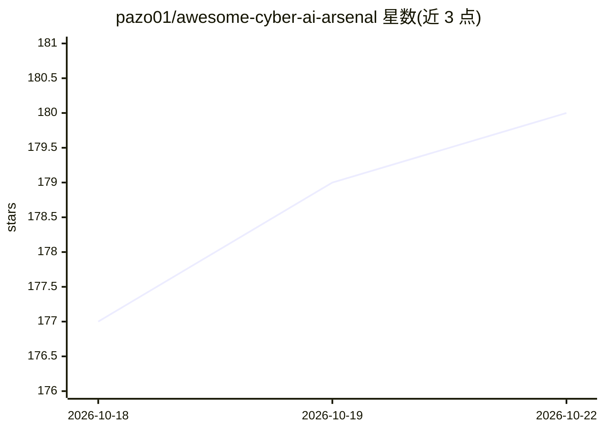

# pazo01/awesome-cyber-ai-arsenal

⭐ 180 · MIT · 推送 2026-10-11 · [GitHub](https://github.com/pazo01/awesome-cyber-ai-arsenal) · 个人维护

**网络安全与 AI/LLM 安全工具策展清单，供攻防选型**

由个人维护的 curated 工具清单，按红队（侦察、端口扫描、爬虫、注入、XSS、SSRF、JWT 破解、C2、钓鱼等）、蓝队（取证、SAST、依赖扫描、秘密检测、TLS 测试等）和 AI/LLM 安全三大板块组织，每个条目给出工具名与一句功能描述。README 明确声明仅供授权安全测试与教育用途。目录含徽章统计（工具数、分类数、AI Security 占比等）。作为清单本体不提供安装或运行方式，仅链接外部工具仓库。

## 筛选速览

| 维度 | 判定 | 备注 |
|---|---|---|
| AI 角色 | `ai-knowledge` | 知识聚合/清单类 |
| 许可风险 | `permissive` | MIT |
| 部署形态 | `None` |  |
| 模型依赖 | — | README 未给出锁定关系 |
| 硬件要求 | — | 无带数字的原话,不猜 |
| 安装摩擦 | `low` | 无编译、无系统依赖或容器化 |
| 成熟度 | — | 结构信号不足 |

## 能力要点

- 红队/蓝队/AI-LLM 安全三大板块与细分子类的分类组织
- 覆盖侦察、注入、XSS、SSRF、取证、SAST、秘密检测等数十个子类
- AI/LLM 安全板块按进攻型 agent、LLM 红队、防御 guardrail、本地模型、知识划分
- 声明仅限授权测试与教育用途的免责条款

## 适用场景

- 渗透测试前按攻击阶段快速查找对应工具
- 蓝队/SOC 搭建防御与检测工具链时选型参考
- 了解面向和针对 AI/LLM 的安全工具生态

## 场景标签

 · 领域:网络安全/知识聚合

## 证据(README 行号)

> L7: Everything is split into **🔴 Offensive (Red Team)**, **🔵 Defensive (Blue Team)** and **🤖 AI / LLM Security**, with s
> L325: > The core reason this repo exists: security tooling powered by (and targeting) AI/LLMs. Split into **offensive ag

## 星数曲线

2026-10-18 177 → 2026-10-22 180（+3）

---
*卡片 v1 · prompt 1.4 · 生成 2026-10-22 · 置信度 high · 依据 README sha `ddabff29f585` · [字段定义](../../DATASET.md)*
