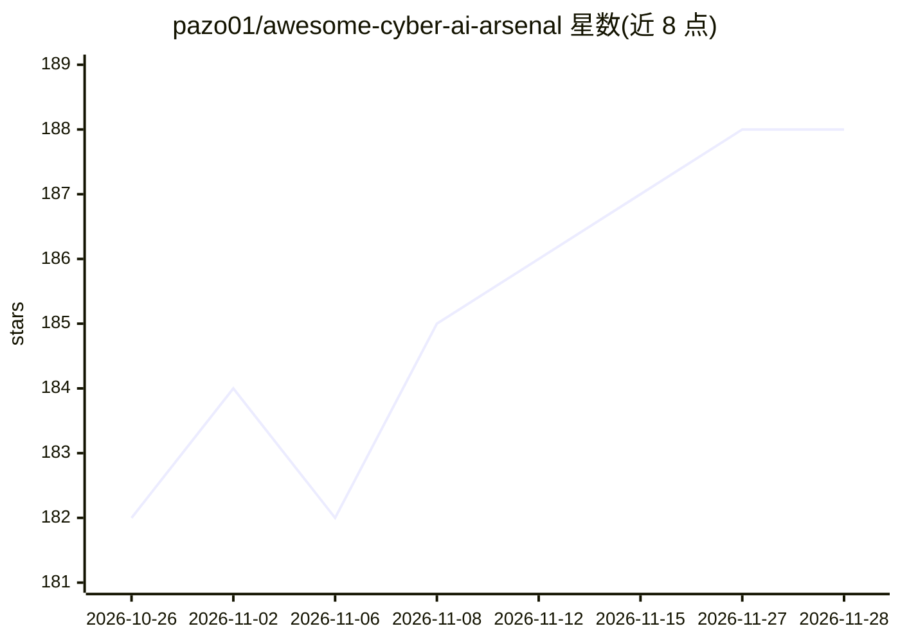

# pazo01/awesome-cyber-ai-arsenal

⭐ 188 · MIT · 推送 2026-10-29 · [GitHub](https://github.com/pazo01/awesome-cyber-ai-arsenal) · 个人维护

**面向安全从业者的攻防与 AI 安全工具清单**

一个将工具按红队（侦察、扫描、注入、XSS、SSRF、C2 等）、蓝队（DFIR、SAST、供应链扫描、密钥检测、TLS 测试等）和 AI/LLM 安全三大板块组织的策展清单，以表格形式收录工具名与一句话描述。定位为授权安全测试与教育用途的索引资源（L15-L16 附使用警告与免责声明）。README 可见部分为条目列表，AI/LLM 板块说明其分为攻击型 agent、LLM red teaming、防御 guardrails、本地模型与知识等子类（L325）。

## 筛选速览

| 维度 | 判定 | 备注 |
|---|---|---|
| AI 角色 | `ai-knowledge` | 知识聚合/清单类 |
| 许可风险 | `permissive` | MIT |
| 部署形态 | `None` |  |
| 模型依赖 | local-ok | 支持本地模型 |
| 硬件要求 | — | 无带数字的原话,不猜 |
| 安装摩擦 | `low` | 无编译、无系统依赖或容器化 |
| 成熟度 | — | 结构信号不足 |

## 能力要点

- 按红队/蓝队/AI 安全三大板块及子类组织的工具清单
- 收录侦察、扫描、注入、密码破解、取证、供应链扫描等多类工具条目
- 附授权测试用途警告与免责声明

## 适用场景

- 查找某类安全测试（如子域枚举、SQL 注入）的候选工具
- 了解 AI/LLM 安全工具生态的覆盖范围
- 搭建安全工具箱时做条目参考

## 场景标签

`网络安全` `精选清单` · 领域:学习与行业

## 证据(README 行号)

> L1: Awesome Cyber AI Arsenal
> L7: Everything is split into **🔴 Offensive (Red Team)**, **🔵 Defensive (Blue Team)** and **🤖 AI / LLM Security**, with s
> L325: > The core reason this repo exists: security tooling powered by (and targeting) AI/LLMs. Split into **offensive ag

## 星数曲线

2026-10-26 182 → 2026-11-28 188（+6）

---
*卡片 v1 · prompt 1.4 · 生成 2026-11-26 · 置信度 high · 依据 README sha `cefb7726d407` · [字段定义](../../DATASET.md)*
