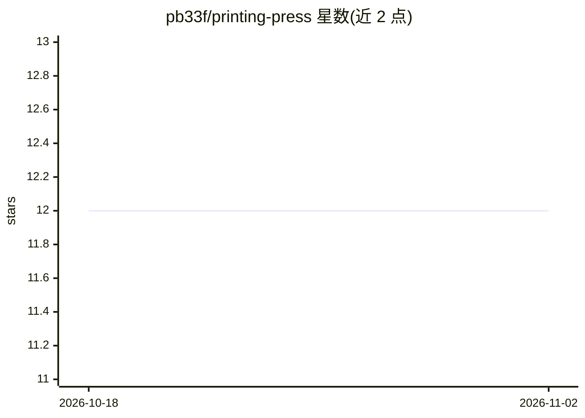

# pb33f/printing-press

⭐ 12 · Go · Apache-2.0 · 推送 2026-10-06 · [GitHub](https://github.com/pb33f/printing-press) · [官网](https://pb33f.io/printing-press/) · 组织维护

**将 OpenAPI/AsyncAPI 契约生成离线静态文档与 agent 输出物**

命令行工具，读取 OpenAPI 与 AsyncAPI 契约文件，生成可 100% 离线打开、可发布到任意静态主机的 API 文档站点；同时输出面向 AI agent 的产物（AGENTS.md、llms.txt、按操作/模型拆分的 markdown 与 JSON 工件），支持从多个 spec 目录生成多版本感知的 API 目录，内置 vacuum 诊断报告渲染与 Mermaid/UML 类图自动生成。提供 curl 脚本、npm、Homebrew、Go、Docker 五种安装方式，npm 路径需 Node 20+。由 Princess Beef Heavy Industries, LLC 维护。

## 筛选速览

| 维度 | 判定 | 备注 |
|---|---|---|
| AI 角色 | `ai-enhanced` | 去掉 AI 部分产品仍成立 |
| 许可风险 | `permissive` | Apache-2.0 |
| 部署形态 | `self-host` | docker 或自建部署 |
| 模型依赖 | — | README 未给出锁定关系 |
| 硬件要求 | — | 无带数字的原话,不猜 |
| 安装摩擦 | `low` | 无编译、无系统依赖或容器化 |
| 成熟度 | — | 结构信号不足 |

## 能力要点

- 从 OpenAPI/AsyncAPI 契约生成 100% 离线可用的静态文档
- 内置 AGENTS.md、llms.txt 等面向 agent 的 markdown 与 JSON 输出
- 多版本感知的 API 目录生成
- vacuum 诊断报告内联渲染与 Mermaid/UML 类图自动生成

## 适用场景

- 为团队 API 契约生成可离线分发或发布到静态主机的文档
- 为 AI agent 准备 llms.txt、AGENTS.md 等 API 上下文材料
- 汇总多个 spec 目录生成 API 目录并查看诊断报告

## 场景标签

 · 领域:API 文档/开发工具

## 证据(README 行号)

> L10: `printing-press` turns OpenAPI and AsyncAPI contracts into beautiful, fast, portable API documentation for humans *
> L14: - **AI and agent output** built in. `AGENTS.md`, `llms.txt`, per-operation and per-model markdown, plus JSON artifa

## 星数曲线

2026-10-18 12 → 2026-11-02 12（+0）

---
*卡片 v1 · prompt 1.4 · 生成 2026-11-01 · 置信度 high · 依据 README sha `1914fe98843a` · [字段定义](../../DATASET.md)*
