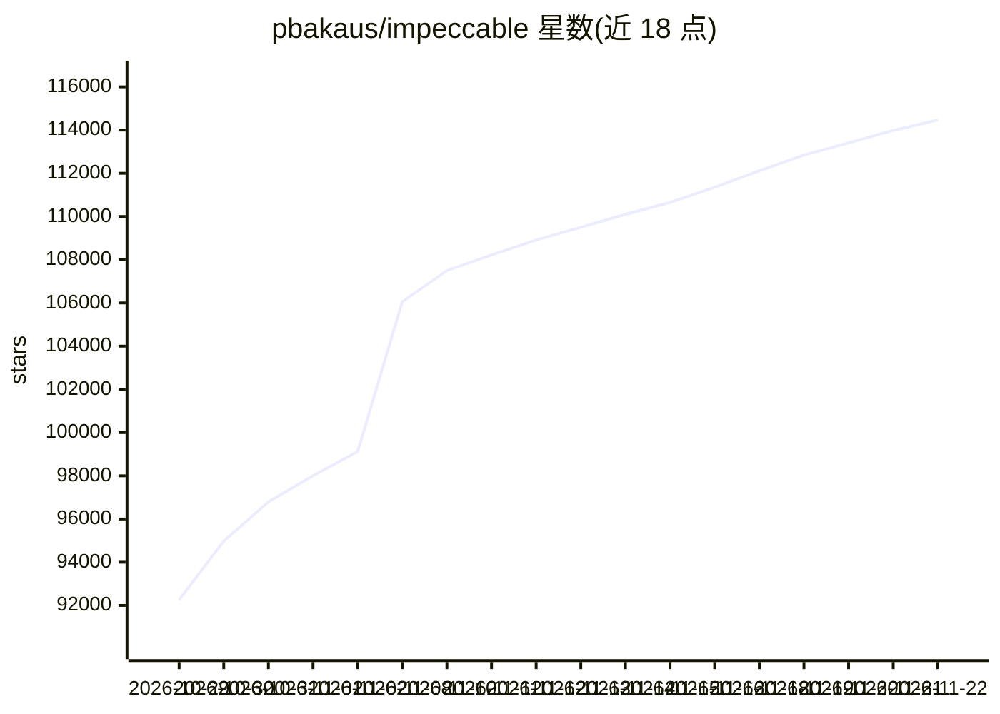

# pbakaus/impeccable

⭐ 114,466 · Rust · Apache-2.0 · 推送 2026-11-21 · [GitHub](https://github.com/pbakaus/impeccable) · [官网](https://impeccable.style) · 个人维护

**给编码 agent 的设计词汇与 UI 审查工具集**

以 agent skill 形式安装的 UI 设计工具集，提供 24 个斜杠命令：bolder/polish/quieter 等用于引导 agent 调整界面设计方向，critique/audit 用于按可用性启发式与技术质量评分并按 P0–P3 排序问题，另含由 62 条确定性规则驱动的 slop 检测器（无 LLM、无 API key），可经 agent 钩子、CLI、CI（GitHub code scanning/SARIF 上传）或 Chrome 扩展运行。支持 Claude Code、Cursor、Codex CLI 等 20+ 编码工具；live 模式可在浏览器中选中元素并回写源码。Node 仅 npx 需要，引擎为自包含二进制。

## 筛选速览

| 维度 | 判定 | 备注 |
|---|---|---|
| AI 角色 | `ai-ecosystem` | LLM/agent 周边工具 |
| 许可风险 | `permissive` | Apache-2.0 |
| 部署形态 | `library` | 以包/库形式分发 |
| 模型依赖 | — | README 未给出锁定关系 |
| 硬件要求 | — | 无带数字的原话,不猜 |
| 安装摩擦 | `low` | 无编译、无系统依赖或容器化 |
| 成熟度 | — | 结构信号不足 |

## 能力要点

- 24 个斜杠命令覆盖引导、审查、收尾、迭代与规划
- 62 条确定性规则的 slop 检测器，无需 LLM 与 API key
- 三种检测运行方式：agent 钩子、CLI/CI（SARIF 上传）、Chrome 扩展
- live 模式在浏览器中选中元素并热替换变体回写源码

## 适用场景

- 让编码 agent 修改页面时按指定设计方向迭代
- 在 CI 中检测 AI 生成界面的一致性并阻断新引入问题
- 浏览器中逐元素对比设计变体后写回代码

## 场景标签

`代码审查` · 领域:编码与开发

## 证据(README 行号)

> L3: The design vocabulary for your coding agent. Steer with `polish` and `bolder`, review with `critique` and `audit`, a
> L29: - **A slop detector.** 62 deterministic rules flag the tells above, plus quality problems like cramped padding and 
> L114: Node is only needed for `npx`. The skill itself runs a self-contained engine binary that ships next to it or downl

## 星数曲线

2026-10-29 92,253 → 2026-11-22 114,466（+22,213）

---
*卡片 v1 · prompt 1.4 · 生成 2026-11-22 · 置信度 high · 依据 README sha `f5eec91440eb` · [字段定义](../../DATASET.md)*
