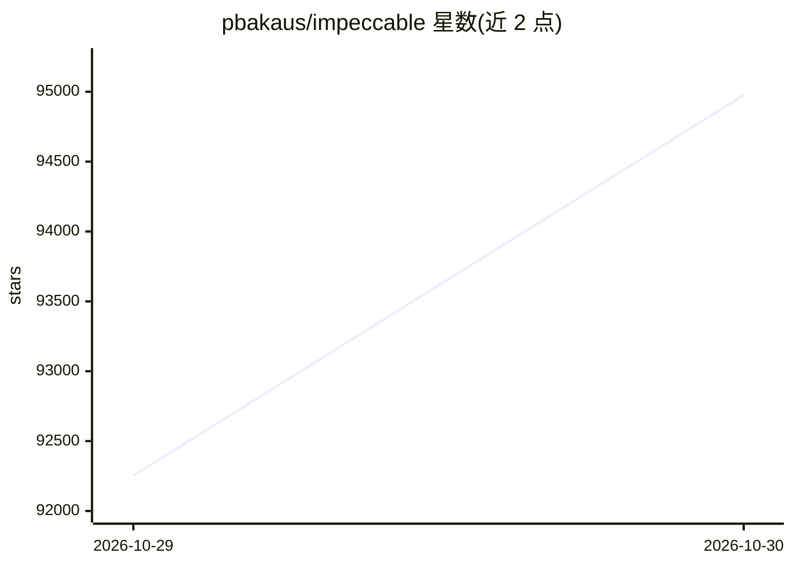

# pbakaus/impeccable

⭐ 94,976 · Rust · Apache-2.0 · 推送 2026-10-29 · [GitHub](https://github.com/pbakaus/impeccable) · [官网](https://impeccable.style) · 个人维护 · 中文 README

**给 AI 编码 agent 的前端设计技能包：24 条命令与设计检测规则**

安装到各类 AI 编码工具（Claude Code、Cursor、Codex、Gemini CLI、Copilot 等）中的设计技能：提供 /impeccable 命令体系（init 写入 PRODUCT.md、craft/critique/audit/polish 等 24 条命令），以及 62 条确定性检测规则（CLI 与浏览器扩展运行，无需 LLM 与 API key），另有仅 LLM 的评审检查，用于约束与改进 AI 生成的前端设计。技能本体无需自身运行时，附带自包含二进制引擎，支持 npx 安装、Git submodule、插件市场与手动复制等安装方式。

## 筛选速览

| 维度 | 判定 | 备注 |
|---|---|---|
| AI 角色 | `ai-ecosystem` | LLM/agent 周边工具 |
| 许可风险 | `permissive` | Apache-2.0 |
| 部署形态 | `desktop` | 安装包/桌面程序 |
| 模型依赖 | — | README 未给出锁定关系 |
| 硬件要求 | — | 无带数字的原话,不猜 |
| 安装摩擦 | `low` | 无编译、无系统依赖或容器化 |
| 成熟度 | — | 结构信号不足 |

## 能力要点

- 24 条设计命令（init/craft/critique/audit/polish/bolder 等）
- 62 条确定性检测规则，CLI 与浏览器扩展运行，无需 LLM 与 API key
- 通过 npx 安装器检测并安装到多种 AI 编码工具
- 附设计反模式清单（字体滥用、灰字彩底、卡片嵌套等）

## 适用场景

- 让 AI 编码 agent 在写前端时遵循统一设计语言
- 上线前对 AI 生成界面做可访问性与设计审计
- 通过命令调整设计风格（bolder/quieter/colorize/animate）

## 场景标签

`提示工程` · 领域:Agent 开发

## 证据(README 行号)

> L3: Design guidance for AI coding agents. 1 skill, 24 commands, live browser iteration, and 62 deterministic detector ru
> L16: - **62 deterministic detector rules** plus LLM-only critique checks. The CLI and browser extension run the determin

## 星数曲线

2026-10-29 92,253 → 2026-10-30 94,976（+2,723）

---
*卡片 v1 · prompt 1.4 · 生成 2026-10-28 · 置信度 high · 依据 README sha `9067a8bb2eb2` · [字段定义](../../DATASET.md)*
