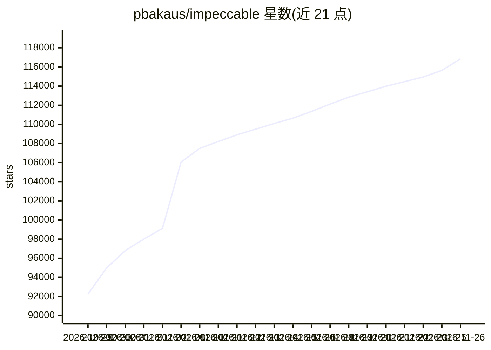

# pbakaus/impeccable

⭐ 116,854 · Rust · Apache-2.0 · 推送 2026-11-25 · [GitHub](https://github.com/pbakaus/impeccable) · [官网](https://impeccable.style) · 个人维护

**给编码代理的设计词汇表：引导润色与审查，拦截 AI slop**

为编码代理（Claude Code、Cursor、Codex CLI 等约 22 种工具）安装的技能包，提供 24 个斜杠命令分四类：Steer（bolder/polish 等改样式）、Review（critique 按 UX 启发式打分、audit 按 P0–P3 分级输出可访问性/性能报告）、Finish、Iterate。核心机制之一是 62 条确定性规则组成的 slop 检测器，无 LLM、无 API key，可在 agent 钩子、CLI（含 GitHub code scanning SARIF 上传）与 Chrome 扩展三处运行。以 npx 安装，引擎为自包含二进制；live 模式需本地 dev server。

## 筛选速览

| 维度 | 判定 | 备注 |
|---|---|---|
| AI 角色 | `ai-ecosystem` | LLM/agent 周边工具 |
| 许可风险 | `permissive` | Apache-2.0 |
| 部署形态 | `library` | 以包/库形式分发 |
| 模型依赖 | — | README 未给出锁定关系 |
| 硬件要求 | — | 无带数字的原话,不猜 |
| 安装摩擦 | `low` | 无编译、无系统依赖或容器化 |
| 成熟度 | — | 结构信号不足 |

## 能力要点

- 24 个斜杠命令覆盖引导、审查、收尾与实时迭代
- 62 条确定性规则的 slop 检测器，无需 LLM 与 API key
- 检测器可在 agent 钩子、CLI/CI（SARIF 上传）、Chrome 扩展三种方式运行
- live 模式在浏览器中选中元素并热替换变体，支持 Vite/Next/SvelteKit/Astro/Nuxt

## 适用场景

- 让编码代理改 UI 时避免千篇一律的默认风格
- 在 CI 中扫描 AI 生成的页面并只在 PR 上报告新增问题
- 对已有组件运行 critique/audit 得到按优先级排序的修改清单

## 场景标签

`代码审查` · 领域:编码与开发

## 证据(README 行号)

> L3: The design vocabulary for your coding agent. Steer with `polish` and `bolder`, review with `critique` and `audit`, a
> L13: Works with Claude Code, Cursor, Codex CLI, GitHub Copilot, Devin, Replit Agent, Gemini CLI, Grok Build, OpenCode, G

## 星数曲线

2026-10-29 92,253 → 2026-11-26 116,854（+24,601）

---
*卡片 v1 · prompt 1.4 · 生成 2026-11-26 · 置信度 high · 依据 README sha `9f6291a1f92e` · [字段定义](../../DATASET.md)*
