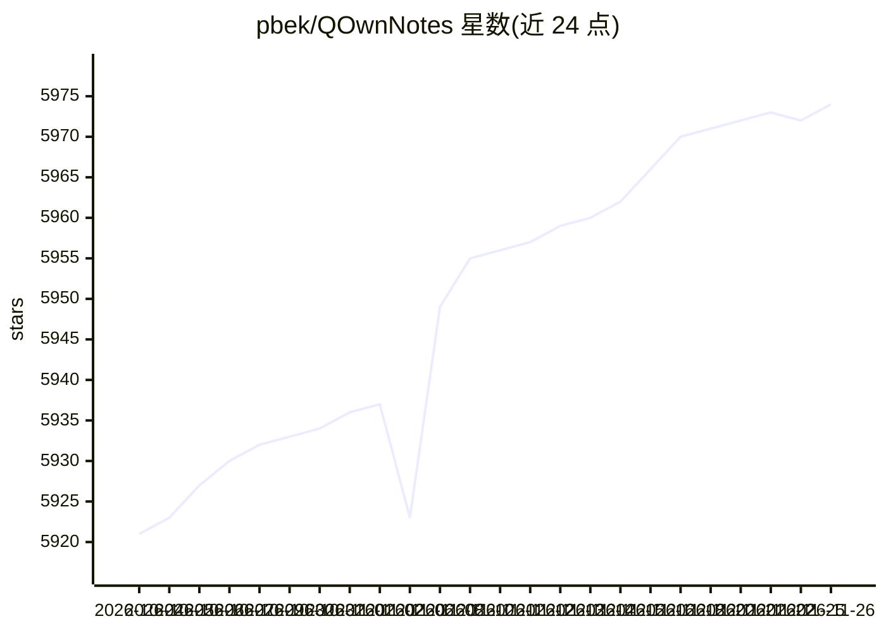

# pbek/QOwnNotes

⭐ 5,974 · C++ · GPL-2.0 · 推送 2026-11-24 · [GitHub](https://github.com/pbek/QOwnNotes) · [官网](https://www.qownnotes.org/) · 组织维护

**本地 Markdown 笔记与待办管理器，支持 Nextcloud 同步**

QOwnNotes 是开源纯文本记事本与待办清单管理器，运行于 GNU/Linux、macOS 和 Windows，笔记以 Markdown 纯文本文件存储，可经 Nextcloud/ownCloud 文件同步访问，移动端可通过配套 Android 应用或 WebDAV 客户端查看。功能包括多笔记文件夹、笔记版本与回收站恢复、脚本系统与在线脚本仓库、CalDAV 任务管理、AES-256 加密、便携模式与 Vim 模式。内置 AI 支持（OpenAI、Groq 脚本集成）与 MCP 服务器。安装走发行打包渠道或从源码构建，构建需 Qt 与编译工具链。

## 筛选速览

| 维度 | 判定 | 备注 |
|---|---|---|
| AI 角色 | `ai-enhanced` | 去掉 AI 部分产品仍成立 |
| 许可风险 | `viral` | GPL-2.0 |
| 部署形态 | `None` |  |
| 模型依赖 | locked-api |  |
| 硬件要求 | — | 无带数字的原话,不猜 |
| 安装摩擦 | `medium` | 含编译或系统依赖之一 |
| 成熟度 | — | 结构信号不足 |

## 能力要点

- 笔记存储为纯文本 Markdown 文件，可配合 Nextcloud/ownCloud 同步
- 脚本系统与在线脚本仓库，支持扩展
- 内置 AI 支持（OpenAI、Groq）与 MCP server，供外部 agent 检索笔记
- 笔记版本/回收站恢复、AES-256 加密、便携模式与 Vim 模式

## 适用场景

- 在本地以纯文本 Markdown 管理笔记与待办
- 配合 Nextcloud 在移动设备上查看和编辑笔记
- 通过浏览器扩展从网页选中文字快速收集笔记

## 场景标签

`知识库管理` · 领域:知识与检索

## 证据(README 行号)

> L27: QOwnNotes is the **open source notepad** with
> L101: - built-in **AI support** with script integration for providers like **OpenAI** and **Groq**
> L195: - A desktop operating system, that supports Qt

## 星数曲线

2026-10-24 5,921 → 2026-11-26 5,974（+53）

---
*卡片 v1 · prompt 1.4 · 生成 2026-11-22 · 置信度 high · 依据 README sha `935b1ed27deb` · [字段定义](../../DATASET.md)*
