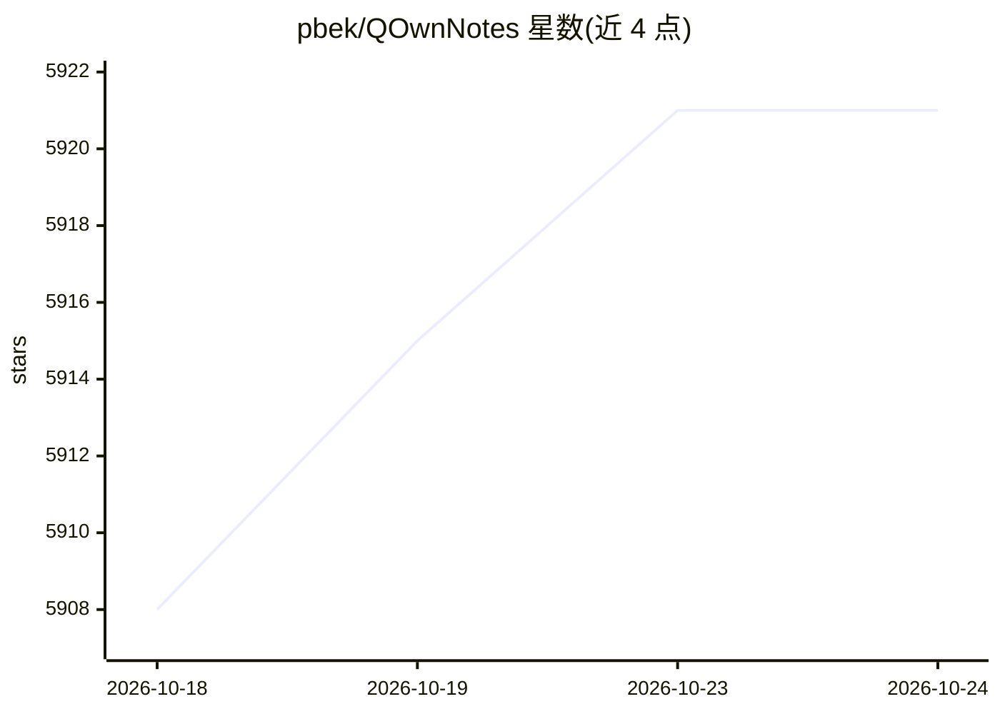

# pbek/QOwnNotes

⭐ 5,921 · C++ · GPL-2.0 · 推送 2026-10-23 · [GitHub](https://github.com/pbek/QOwnNotes) · [官网](https://www.qownnotes.org/) · 个人维护

**面向 Nextcloud/ownCloud 的开源纯文本 Markdown 笔记与待办桌面应用**

C++/Qt 编写的跨平台（GNU/Linux、macOS、Windows）笔记应用，笔记以纯文本 Markdown 文件存储，通过 Nextcloud/ownCloud 文件同步，也可用 Syncthing 或 Dropbox 同步。功能含多笔记文件夹、版本与回收站恢复、标签、子文件夹、Vim 模式、便携模式、AES-256 笔记加密、脚本系统及 Evernote/Joplin 导入。内置 AI 支持（可接入 OpenAI、Groq 等服务）并带 MCP 服务器供外部 AI agent 检索笔记。支持 CalDAV 待办管理与浏览器扩展。

## 筛选速览

| 维度 | 判定 | 备注 |
|---|---|---|
| AI 角色 | `ai-enhanced` | 去掉 AI 部分产品仍成立 |
| 许可风险 | `viral` | GPL-2.0 |
| 部署形态 | `None` |  |
| 模型依赖 | locked-api |  |
| 硬件要求 | — | 无带数字的原话,不猜 |
| 安装摩擦 | `medium` | 含编译或系统依赖之一 |
| 成熟度 | — | 结构信号不足 |

## 能力要点

- 笔记为纯文本 Markdown 文件，经 Nextcloud/ownCloud 同步，可在移动端编辑
- 内置 AI 支持（脚本集成 OpenAI、Groq 等）与 MCP 服务器供外部 agent 安全检索笔记
- 支持笔记版本/回收站恢复、AES-256 加密、标签、Vim 模式与便携模式
- 脚本系统含在线脚本仓库，浏览器扩展可从网页添加笔记

## 适用场景

- 在桌面写 Markdown 笔记并与 Nextcloud/ownCloud 同步，移动端继续编辑
- 管理 Nextcloud/ownCloud 或其他 CalDAV 服务器的待办列表
- 通过 AI 服务与 MCP 服务器让外部 agent 检索我的笔记
- 把 Evernote/Joplin 笔记迁移到纯文本 Markdown

## 场景标签

`知识库管理` · 领域:知识与检索

## 证据(README 行号)

> L27: QOwnNotes is the **open source notepad** with
> L101: - built-in **AI support** with script integration for providers like **OpenAI** and **Groq**

## 星数曲线

2026-10-18 5,908 → 2026-10-24 5,921（+13）

---
*卡片 v1 · prompt 1.4 · 生成 2026-10-20 · 置信度 high · 依据 README sha `ce8f6454598b` · [字段定义](../../DATASET.md)*
