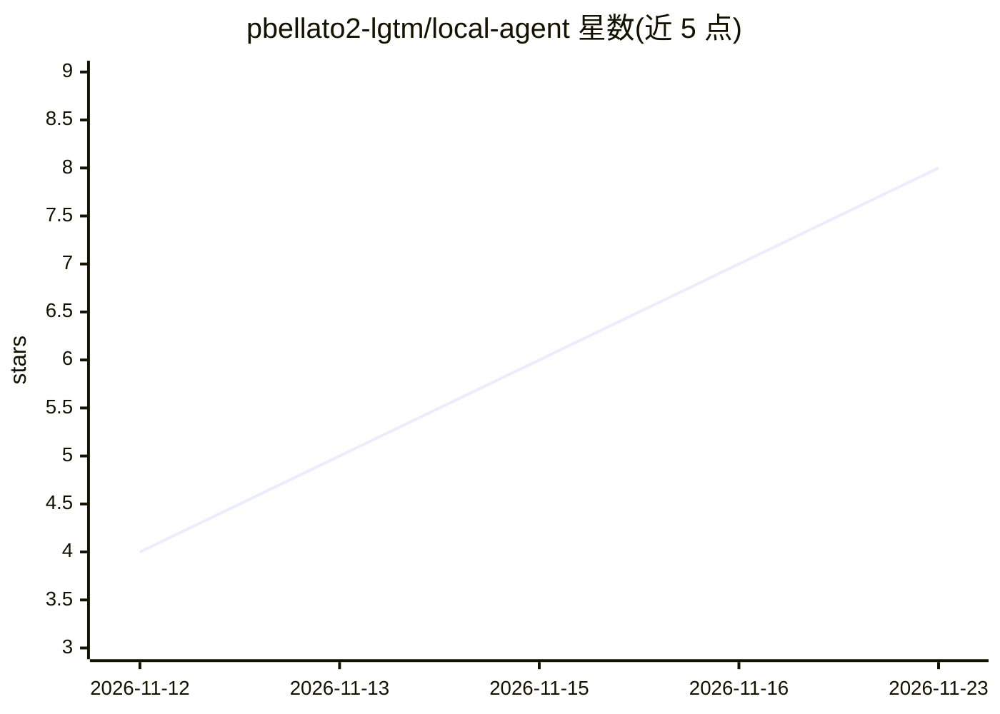

# pbellato2-lgtm/local-agent

⭐ 8 · JavaScript · 推送 2026-11-11 · [GitHub](https://github.com/pbellato2-lgtm/local-agent) · 个人维护

**Windows 本地 AI Agent 桌面客户端，直连所选 AI 提供商**

基于 Rust 与 WebView2 的 Windows 本地 AI Agent 应用，浏览器与本地进程、进程与所选 AI 提供商直接通信，无中间服务器。提供流式聊天、会话文件夹与归档、Skill 系统（兼容 Claude/OpenCode 格式 SKILL.md）、图像生成工具、多模型 fallback、跨会话召回，以及带管理员模式（UAC）的 PowerShell/CMD/WSL 集成终端。API key 保存在本地 config.json。v2.1.0 增加会话全量记忆与磁盘上的 ledger 事实记录。需 Windows 10/11 x64 与 WebView2 Runtime。

## 筛选速览

| 维度 | 判定 | 备注 |
|---|---|---|
| AI 角色 | `ai-native` | 本体是模型或模型工具 |
| 许可风险 | `none` | — |
| 部署形态 | `desktop` | 安装包/桌面程序 |
| 模型依赖 | local-ok | 支持本地模型 |
| 硬件要求 | — | 无带数字的原话,不猜 |
| 安装摩擦 | `medium` | 含编译或系统依赖之一 |
| 成熟度 | — | 结构信号不足 |

## 能力要点

- 多提供商聊天：OpenAI、Anthropic、Google、NVIDIA、Groq、xAI、Mistral、Ollama 及自定义
- 兼容 Claude/OpenCode 格式的 Skill 系统（SKILL.md）
- 集成 PowerShell/CMD/WSL 终端，带 UAC 管理员会话与本地 token 保护
- 会话 ledger 持久化到 session_memory.json，多模型 fallback

## 适用场景

- 在 Windows 桌面上通过一个客户端使用多家 AI 提供商
- 让 AI Agent 通过集成终端在本机执行命令
- 安装社区 Skill 扩展 Agent 能力

## 场景标签

`AI 助手` `编码 Agent` `图像生成` · 领域:编码与开发

## 证据(README 行号)

> L3: Agente de IA local para Windows. Aplicativo nativo em Rust com interface WebView2, sem servidor intermediario. O bro
> L17: - **Chat com IA** - streaming em tempo real, multiplos provedores (OpenAI, Anthropic, Google, NVIDIA, Groq, xAI, Mi

## 星数曲线

2026-11-12 4 → 2026-11-23 8（+4）

---
*卡片 v1 · prompt 1.4 · 生成 2026-11-20 · 置信度 high · 依据 README sha `1dff8fb50109` · [字段定义](../../DATASET.md)*
