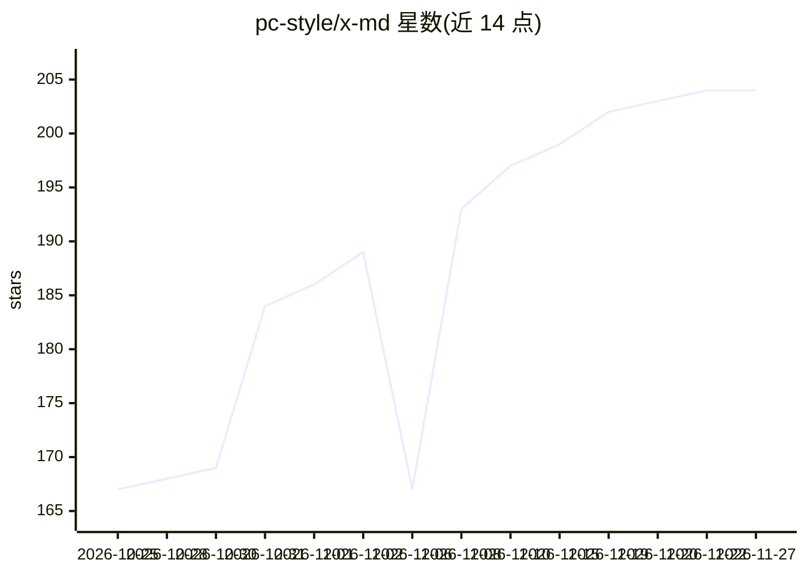

# pc-style/x-md

⭐ 204 · TypeScript · MIT · 推送 2026-11-23 · [GitHub](https://github.com/pc-style/x-md) · [官网](https://mdfromx.com) · 个人维护

**给 agent 用的 X 内容转 Markdown/JSON API 服务**

将公开 X 平台的帖子、会话、主页、搜索结果与关注关系转换为紧凑 Markdown 或 JSON，托管于 mdfromx.com，默认路径无需 X API key。返回带来源 URL 的内容、视频直链、会话上下文，支持游标分页、批量导入历史帖子（NDJSON 流式）。机器接口包括 Markdown 协商、/llms.txt、OpenAPI 3.1、MCP server（Streamable HTTP）与编码 agent 的 browse-x 技能；自托管目标为 Bun 1.4。搜索与批量导入有速率限制；/api/convert 与 /api/browse 别名已公布弃用时间表。

## 筛选速览

| 维度 | 判定 | 备注 |
|---|---|---|
| AI 角色 | `ai-ecosystem` | LLM/agent 周边工具 |
| 许可风险 | `permissive` | MIT |
| 部署形态 | `desktop` | 安装包/桌面程序 |
| 模型依赖 | — | README 未给出锁定关系 |
| 硬件要求 | — | 无带数字的原话,不猜 |
| 安装摩擦 | `low` | 无编译、无系统依赖或容器化 |
| 成熟度 | `idea` | |

## 能力要点

- 公开接口无需 key：Markdown 协商、/llms.txt、OpenAPI 3.1、MCP server、AR catalog
- 对话上下文默认返回（父帖、作者线程、热门回复），可参数化收窄
- 历史批量导入：多游标并发拉取，实测 1379 帖 7.8 秒
- 错误为 RFC 9457 问题文档，限流通过 RateLimit 结构化字段通告

## 适用场景

- 让编码 agent 或 MCP 客户端读取 X 帖子与主页内容
- 为 RAG 或研究流程批量导入某账号的历史推文
- 生成可嵌入 Discord/Telegram/Slack 的帖子预览

## 场景标签

`网页抓取` · 领域:效率与自动化

## 证据(README 行号)

> L3: Turn public X posts, conversations, profiles, search results, and social graphs into compact Markdown for agents. Th
> L49: |`/mcp`|mdfromx.com/mcp|MCP server over Streamable HTTP, exposing the same reads as tools|
> L50: |Agent skill|`bunx skills add pc-style/x-md -g -y --skill browse-x`|The `browse-x` skill for coding agents|

## 星数曲线

2026-10-25 167 → 2026-11-27 204（+37）

---
*卡片 v1 · prompt 1.4 · 生成 2026-11-26 · 置信度 high · 依据 README sha `3cb5a69fead3` · [字段定义](../../DATASET.md)*
