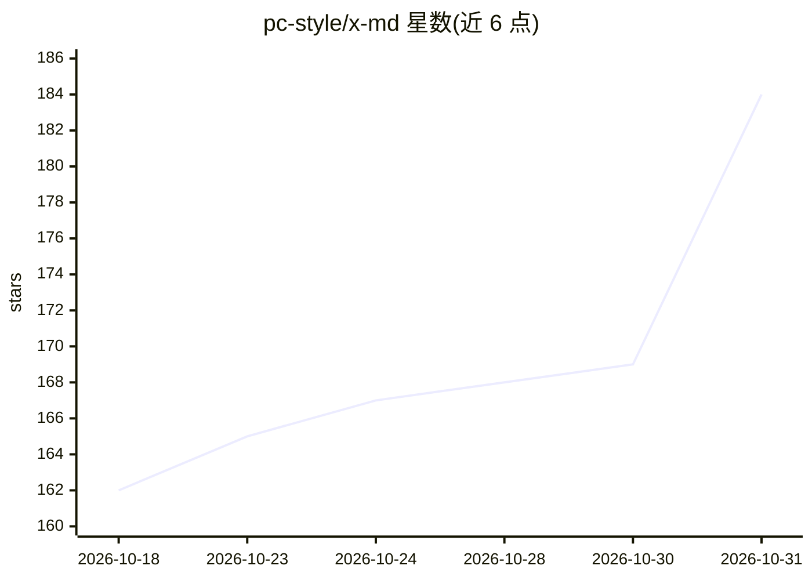

# pc-style/x-md

⭐ 184 · TypeScript · MIT · 推送 2026-10-30 · [GitHub](https://github.com/pc-style/x-md) · [官网](https://mdfromx.com) · 个人维护

**把公开 X 帖子/主页/搜索转为 Markdown/JSON 的 API 服务**

自托管或托管的 Web 服务（托管于 mdfromx.com），将公开 X 帖子、会话、主页、搜索、关注关系与批量历史导入转换为面向 agent 的紧凑 Markdown 或结构化 JSON，默认无需 X API key。数据来源为 FxTwitter 主通道与 X syndication 回退，可选 Context.dev 与 Firecrawl。为程序化消费提供 /llms.txt、OpenAPI 3.1、MCP server、agent skill（browse-x）、ARD 目录与 RFC 9457 错误文档，响应带结构化限速头。自声明 beta，部分旧别名路由已宣布 2026-09-15 弃用。

## 筛选速览

| 维度 | 判定 | 备注 |
|---|---|---|
| AI 角色 | `ai-ecosystem` | LLM/agent 周边工具 |
| 许可风险 | `permissive` | MIT |
| 部署形态 | `desktop` | 安装包/桌面程序 |
| 模型依赖 | — | README 未给出锁定关系 |
| 硬件要求 | — | 无带数字的原话,不猜 |
| 安装摩擦 | `low` | 无编译、无系统依赖或容器化 |
| 成熟度 | `idea` | |

## 能力要点

- 帖子/主页/搜索/关注/批量历史（≤5000 帖，NDJSON 流式）转 Markdown 或 JSON
- 面向 agent 的机器表面：/llms.txt、/openapi.json、/mcp（Streamable HTTP）、browse-x 技能、ARD 目录
- RFC 9457 错误文档与 IETF RateLimit 结构化限速头，客户端可自行配速
- 默认路径无需 X API key，FxTwitter 主通道 + X syndication 回退

## 适用场景

- 让 LLM agent 读取 X 帖子与会话上下文作为资料
- 批量导入某账号的历史帖子做分析或归档
- 在 Discord/Slack 等平台生成帖子预览嵌入

## 场景标签

`网页抓取` · 领域:效率与自动化

## 证据(README 行号)

> L3: Turn public X posts, conversations, profiles, search results, and social graphs into compact Markdown for agents. Th
> L49: |`/mcp`|mdfromx.com/mcp|MCP server over Streamable HTTP, exposing the same reads as tools|
> L50: |Agent skill|`bunx skills add pc-style/x-md -g -y --skill browse-x`|The `browse-x` skill for coding agents|

## 星数曲线

2026-10-18 162 → 2026-10-31 184（+22）

---
*卡片 v1 · prompt 1.4 · 生成 2026-10-23 · 置信度 high · 依据 README sha `52d1136ec51a` · [字段定义](../../DATASET.md)*
