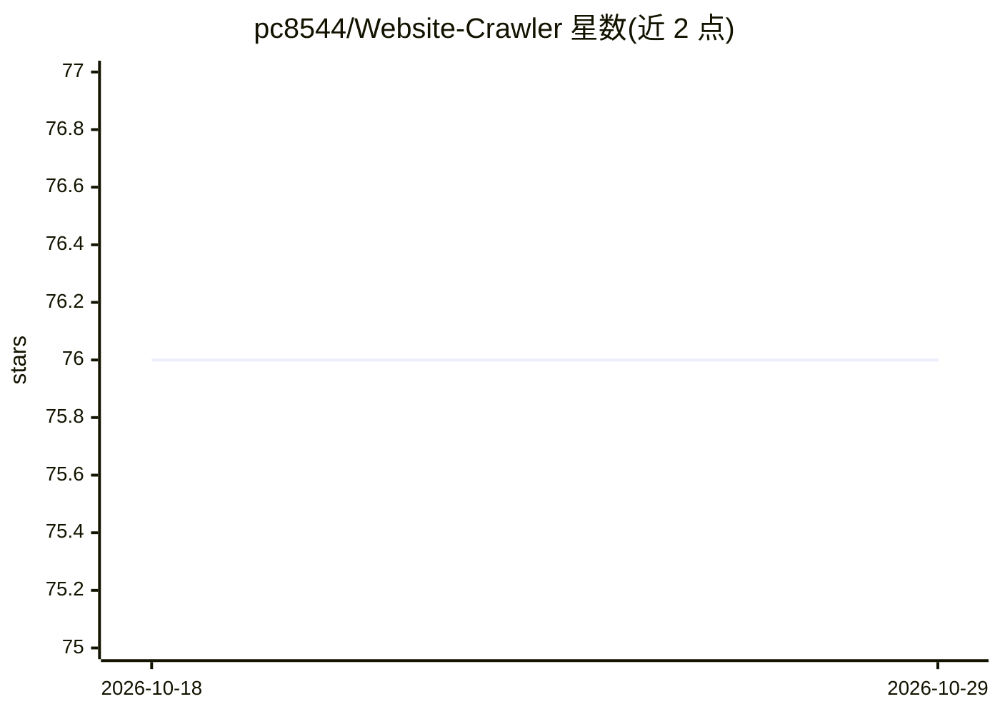

# pc8544/Website-Crawler

⭐ 76 · Java · 推送 2026-02-19 · [GitHub](https://github.com/pc8544/Website-Crawler) · [官网](https://www.websitecrawler.org) · 组织维护

**面向开发者的网站爬取 API，输出 LLM 就绪的 JSON/CSV 数据**

websitecrawler.org 提供的网站爬取 REST API 及多语言 SDK：通过六个端点完成认证、启动爬取（免费层上限 100 页）、获取结构化 JSON 数据、查询当前处理 URL、清除任务与状态跟踪，需注册账户获取 API Key。提供 Python（pip）与 Node.js（npm）SDK，Java 需 JDK 11+ 与 Maven 并引入 jar 包。输出为 JSON/LLM 就绪格式，可用于训练模型、构建聊天机器人、RAG 或站点审计；README 另给出 XML Sitemap Generator 集成示例。本体为托管服务 API，仓库内无本地运行方式。

## 筛选速览

| 维度 | 判定 | 备注 |
|---|---|---|
| AI 角色 | `ai-enhanced` | 去掉 AI 部分产品仍成立 |
| 许可风险 | `none` | — |
| 部署形态 | `library` | 以包/库形式分发 |
| 模型依赖 | — | README 未给出锁定关系 |
| 硬件要求 | — | 无带数字的原话,不猜 |
| 安装摩擦 | `medium` | 含编译或系统依赖之一 |
| 成熟度 | — | 结构信号不足 |

## 能力要点

- 六个 REST 端点覆盖认证、启动爬取、取数、清任务与状态查询
- 输出 JSON/LLM 就绪的结构化爬取数据
- Python / Node.js / Java 三种语言的 SDK 与示例
- 免费层单次爬取上限 100 页

## 适用场景

- 我为 RAG 或聊天机器人准备网站语料数据
- 我需要程序化批量爬取整站并拿到结构化 JSON
- 我基于爬取结果自动生成 XML sitemap 做 SEO

## 场景标签

`网页抓取` · 领域:效率与自动化

## 证据(README 行号)

> L5: The **Website Crawler API** allows developers to programmatically crawl websites and access structured metadata via 
> L169: The Python, Java, nodejs demos showcases how to use the `WebsiteCrawlerSDK` to interact with websitecrawler.org, e

## 星数曲线

2026-10-18 76 → 2026-10-29 76（+0）

---
*卡片 v1 · prompt 1.4 · 生成 2026-10-24 · 置信度 high · 依据 README sha `1463b080b24c` · [字段定义](../../DATASET.md)*
