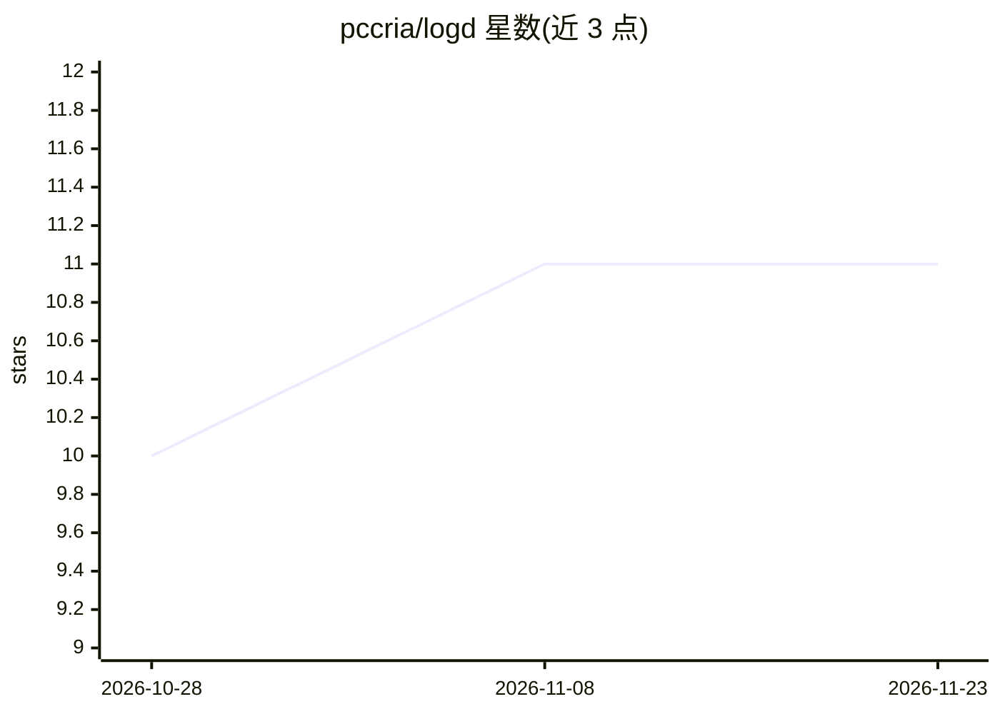

# pccria/logd

⭐ 11 · Dart · BSD-3-Clause · 推送 2026-11-20 · [GitHub](https://github.com/pccria/logd) · [官网](https://www.pub.dev/packages/logd) · 个人维护

**Dart/Flutter 的结构化分层日志引擎，面向开发者可观测性**

面向 Dart 与 Flutter 的结构化分层日志引擎 monorepo，核心机制包括：通过后台 isolate 卸载格式化、序列化与 I/O 以避免主线程卡顿；LogContext.run() 在 async 边界间自动传播请求上下文；支持同时路由到 ANSI 控制台、SQLite（WAL）、HTML 文件与 WebSocket 仪表盘；内含 Dio HTTP 拦截器（计时、脱敏、生成 cURL）；TOON 格式输出面向 AI agent 遥测与 DuckDB 摄取；提供分层噪声控制与故障回退。开发需 Dart SDK 3.6.0+ 与 Melos。

## 筛选速览

| 维度 | 判定 | 备注 |
|---|---|---|
| AI 角色 | `ai-enhanced` | 去掉 AI 部分产品仍成立 |
| 许可风险 | `permissive` | BSD-3-Clause |
| 部署形态 | `None` |  |
| 模型依赖 | — | README 未给出锁定关系 |
| 硬件要求 | — | 无带数字的原话,不猜 |
| 安装摩擦 | `low` | 无编译、无系统依赖或容器化 |
| 成熟度 | — | 结构信号不足 |

## 能力要点

- 后台 isolate 卸载 I/O（.async() handler）
- ambient async 上下文自动传播（requestId/userId）
- 多目的地路由：ANSI/SQLite/HTML/WebSocket
- TOON 紧凑输出格式与 Dio 拦截脱敏

## 适用场景

- Flutter 应用中记录不阻塞 UI 的结构化日志
- 跨 async 调用链追踪请求上下文
- 为 AI agent 遥测生成紧凑的日志格式
- 对 Dio HTTP 请求做计时与敏感信息脱敏

## 场景标签

 · 领域:开发者工具/日志与可观测性

## 证据(README 行号)

> L5:  logd is a high-performance, structured hierarchical logging engine for Dart and Flutter. Engineered for zero-jank b
> L11: - **Cut LLM prompt token costs by 30–50%**: Native **TOON** (Tab-Oriented Object Notation) emits compact schema hea

## 星数曲线

2026-10-28 10 → 2026-11-23 11（+1）

---
*卡片 v1 · prompt 1.4 · 生成 2026-11-18 · 置信度 high · 依据 README sha `d4c5bb0cba25` · [字段定义](../../DATASET.md)*
