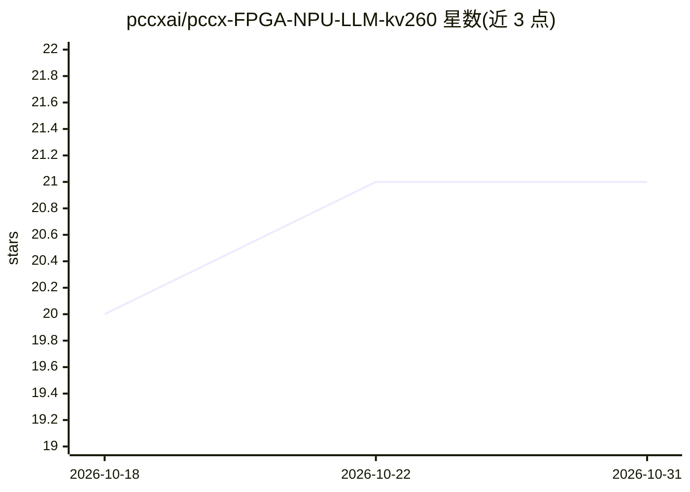

# pccxai/pccx-FPGA-NPU-LLM-kv260

⭐ 21 · Python · Apache-2.0 · 推送 2026-09-27 · [GitHub](https://github.com/pccxai/pccx-FPGA-NPU-LLM-kv260) · [官网](https://docs.pccx.ai/en/docs/v002/) · 组织维护

**KV260 上的开源 SystemVerilog NPU，面向 Gemma 类 LLM 加速**

Altifigence 运营的开源半导体项目：在 AMD/Xilinx Kria KV260 开发板上集成裸机 Transformer 加速器 PCCX v002，以 third_party/pccx-v002 固定版本子模块消费可复用 IP 核。架构含 32×16×2 脉动阵列（GEMM/prefill）、4 通道 GEMV 核（decode）、SFU 非线性单元，W4A8 量化下单 DSP 每周期 2 MAC，峰值约 819 GMAC/s；自带 64 位 VLIW 五指令 ISA 与 KV 量化/滑窗驱逐缓存策略。目标模型为 Gemma 3N E4B。当前为 v0.1.0-alpha 公测：RTL 综合已闭合、xsim 通过，但比特流生成、上板执行与应用接线仍在进行中，非生产发布。

## 筛选速览

| 维度 | 判定 | 备注 |
|---|---|---|
| AI 角色 | `ai-ecosystem` | LLM/agent 周边工具 |
| 许可风险 | `permissive` | Apache-2.0 |
| 部署形态 | `None` |  |
| 模型依赖 | — | README 未给出锁定关系 |
| 硬件要求 | — | 无带数字的原话,不猜 |
| 安装摩擦 | `low` | 无编译、无系统依赖或容器化 |
| 成熟度 | `idea` | |

## 能力要点

- GEMM 脉动阵列 + GEMV 向量核 + SFU 三异构核围绕 1.75MB L2 URAM
- W4A8 位打包实现单 DSP48E2 每周期 2 MAC，峰值约 819 GMAC/s
- 自定义 64 位 VLIW ISA（GEMV/GEMM/MEMCPY/MEMSET/CVO 五指令）
- KV 缓存 INT8/INT4 量化 + attention-sink 滑窗驱逐 + 8192 token 硬上限

## 适用场景

- 在 KV260 开发板上进行 Gemma 类 LLM 的 FPGA 硬件加速实验
- 研究 W4A8 量化脉动阵列与 VLIW 调度的 NPU 微架构
- 跟踪边缘端 LLM 推理加速器的 RTL 实现与板级验证进展

## 场景标签

`推理引擎` · 领域:训练与推理

## 证据(README 行号)

> L16: Open SystemVerilog NPU for experimental Gemma-class LLM acceleration on
> L17: AMD/Xilinx Kria KV260.
> L28: This repo is the **KV260 + PCCX v002 LLM application integration** repo.
> L29: It hosts board integration, bare-metal driver source, application wiring,

## 星数曲线

2026-10-18 20 → 2026-10-31 21（+1）

---
*卡片 v1 · prompt 1.4 · 生成 2026-10-28 · 置信度 high · 依据 README sha `a34ee4a9da57` · [字段定义](../../DATASET.md)*
