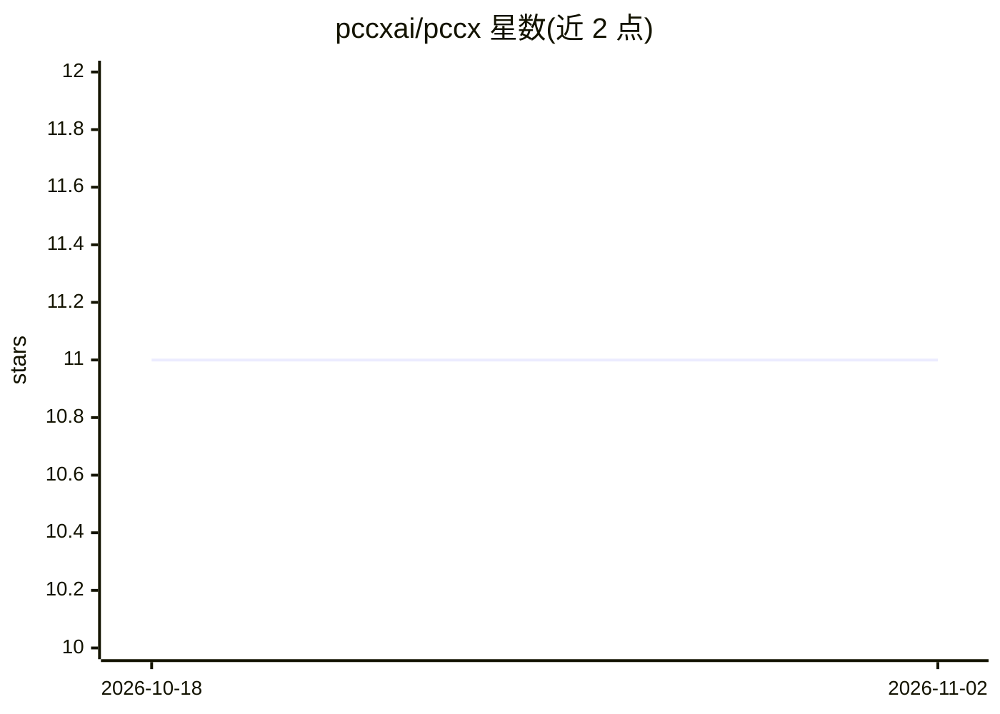

# pccxai/pccx

⭐ 11 · SystemVerilog · NOASSERTION · 推送 2026-09-30 · [GitHub](https://github.com/pccxai/pccx) · [官网](https://docs.pccx.ai/) · 组织维护 · 中文 README

**面向边缘 FPGA 的 LLM 推理 NPU 开源架构与文档项目**

PCCX 是由 Altifigence 公司主导的开源半导体项目，本仓库承载架构规范、ISA 定义与验证文档：面向 Xilinx Kria KV260 SOM 的 Transformer LLM 解码加速 NPU。设计分离 GEMM（32×32 脉动阵列）与 GEMV（4 核向量通路）数据通路，采用 W4A8 量化、自定义 64 位 VLIW ISA 与共享 URAM L2。README 明确声明性能数字为设计目标而非实测，当前处于 v0.1.0-alpha 公测阶段，RTL 与板级验证仍在进行。

## 筛选速览

| 维度 | 判定 | 备注 |
|---|---|---|
| AI 角色 | `ai-ecosystem` | LLM/agent 周边工具 |
| 许可风险 | `none` | NOASSERTION |
| 部署形态 | `library` | 以包/库形式分发 |
| 模型依赖 | — | README 未给出锁定关系 |
| 硬件要求 | — | 无带数字的原话,不猜 |
| 安装摩擦 | `low` | 无编译、无系统依赖或容器化 |
| 成熟度 | `idea` | |

## 能力要点

- GEMM/GEMV 分离数据通路，针对解码期内存带宽瓶颈设计
- W4A8 量化与非线性算子自动升精度到 BF16/FP32
- 自定义 64 位 VLIW ISA（5 个操作码）
- 证据门槛机制：明确区分设计目标与实测结果

## 适用场景

- 研究边缘 FPGA 上的 LLM 推理加速架构
- 参与开源 SystemVerilog 验证任务
- 查阅 NPU ISA 编码与 DSP48E2 位打包推导文档

## 场景标签

 · 领域:半导体/AI 加速器硬件

## 证据(README 行号)

> L14: **A scalable NPU architecture for Transformer LLM inference on edge FPGAs**
> L65: pccx is a hardware-software co-design framework that accelerates **autoregressive decoding** of Transformer-based L

## 星数曲线

2026-10-18 11 → 2026-11-02 11（+0）

---
*卡片 v1 · prompt 1.4 · 生成 2026-11-01 · 置信度 mid · 依据 README sha `054865c9ebcd` · [字段定义](../../DATASET.md)*
