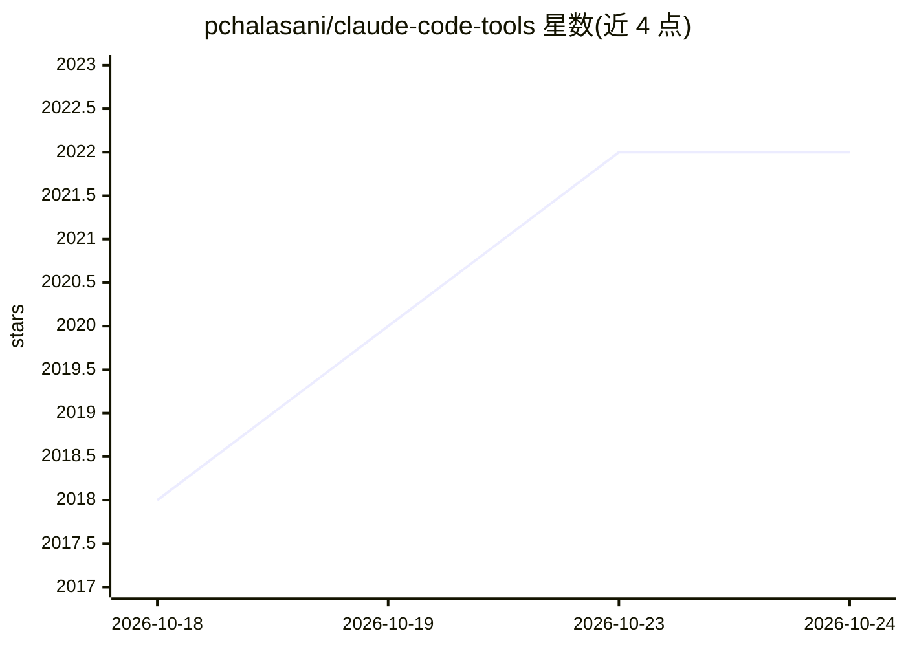

# pchalasani/claude-code-tools

⭐ 2,020 · Python · MIT · 推送 2026-10-24 · [GitHub](https://github.com/pchalasani/claude-code-tools) · 个人维护

**增强 Claude Code 等 CLI 编程代理生产力的工具集**

为 Claude Code、Codex-CLI 等命令行编程代理提供的 CLI 工具、技能（skills）、代理、钩子与插件合集，涵盖 aichat 会话搜索、voxtype 语音输入、tmux-cli/amux 多路复用、会话修复、Claude 与 Codex 会话互转、Google Docs/Sheets 集成、alt-llm-providers 替代模型接入等模块。技能通过 npx 一条命令安装，多数可在任意代理中使用，少数仅限 Claude Code 与 Codex；需要 Node.js 22.20 或更高版本。

## 筛选速览

| 维度 | 判定 | 备注 |
|---|---|---|
| AI 角色 | `ai-ecosystem` | LLM/agent 周边工具 |
| 许可风险 | `permissive` | MIT |
| 部署形态 | `library` | 以包/库形式分发 |
| 模型依赖 | — | README 未给出锁定关系 |
| 硬件要求 | — | 无带数字的原话,不猜 |
| 安装摩擦 | `low` | 无编译、无系统依赖或容器化 |
| 成熟度 | — | 结构信号不足 |

## 能力要点

- 技能通过 npx skills add 一条命令安装，可选单个项目或全局
- 多数技能可在任意 CLI 代理中使用，部分仅限 Claude Code 与 Codex
- 包含 Claude 与 Codex 会话互转、代理间通信（msg）、会话修复等工具
- 提供 Google Docs/Sheets 集成与 alt-llm-providers 替代模型接入

## 适用场景

- 为 Claude Code / Codex-CLI 补充会话管理、语音输入等生产力技能
- 在 Claude 与 Codex 之间迁移或互转会话
- 让 CLI 编程代理接入 Google Docs/Sheets 或替代 LLM 提供商

## 场景标签

`Agent 框架` · 领域:Agent 开发

## 证据(README 行号)

> L6: CLI tools, skills, agents, hooks, and plugins for enhancing productivity with Claude Code and other coding agents.
> L21: every project). Most work in any agent; a few are Claude Code and Codex

## 星数曲线

2026-10-18 2,018 → 2026-10-24 2,022（+4）

---
*卡片 v1 · prompt 1.4 · 生成 2026-10-21 · 置信度 mid · 依据 README sha `61e7a2800b43` · [字段定义](../../DATASET.md)*
