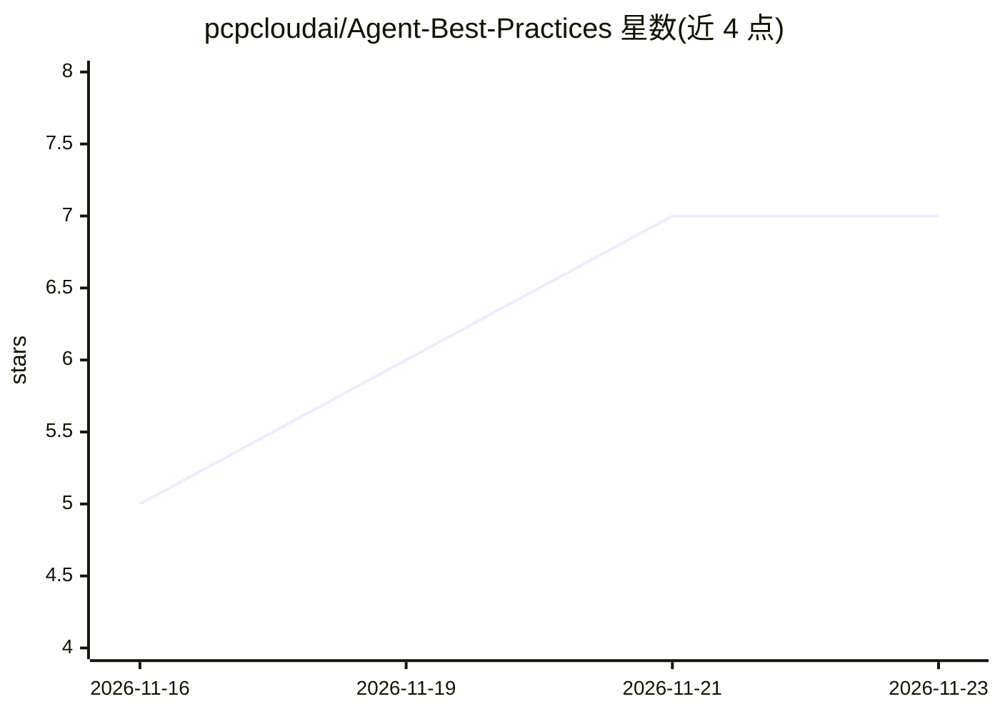

# pcpcloudai/Agent-Best-Practices

⭐ 7 · MIT · 推送 2026-11-16 · [GitHub](https://github.com/pcpcloudai/Agent-Best-Practices) · 组织维护

**企业级 AI Agent 工程模式的实践文档集合**

面向设计、部署与运营大规模可信 Agent 系统的工程实践文档仓库，内容以模式与实践集合形式组织。主题标签涉及 azure、azure-container-apps、rag、zero-trust 等企业环境关键词，README 正文仅含标题、简介与贡献说明，具体章节内容在可见范围内未展示。维护方名称含 pcpcloudai，面向企业/开发场景的构建者。

## 筛选速览

| 维度 | 判定 | 备注 |
|---|---|---|
| AI 角色 | `ai-knowledge` | 知识聚合/清单类 |
| 许可风险 | `permissive` | MIT |
| 部署形态 | `None` |  |
| 模型依赖 | — | README 未给出锁定关系 |
| 硬件要求 | — | 无带数字的原话,不猜 |
| 安装摩擦 | `low` | 无编译、无系统依赖或容器化 |
| 成熟度 | — | 结构信号不足 |

## 能力要点

- 以模式与实践集合形式组织企业级 Agent 工程文档
- 主题标签覆盖 azure-container-apps、rag、zero-trust

## 适用场景

- 参考企业环境下部署 Agent 系统的实践模式
- 了解 zero-trust 架构在 Agent 系统中的应用文档

## 场景标签

`教程课程` · 领域:学习与行业

## 证据(README 行号)

> L3: A collection of patterns and practices for building enterprise-grade AI agents.

## 星数曲线

2026-11-16 5 → 2026-11-23 7（+2）

---
*卡片 v1 · prompt 1.4 · 生成 2026-11-20 · 置信度 mid · 依据 README sha `bae33b92527a` · [字段定义](../../DATASET.md)*
