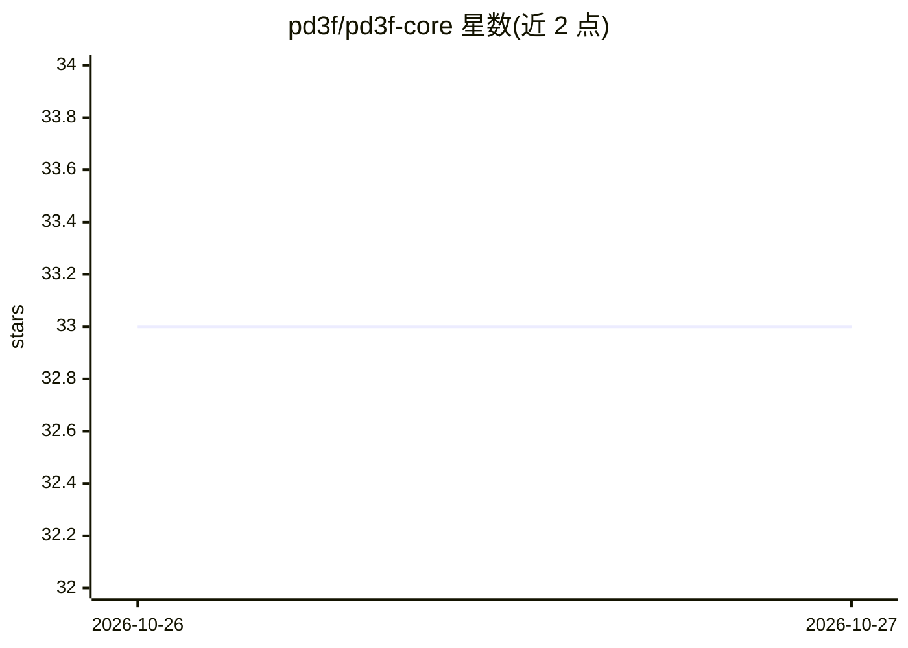

# pd3f/pd3f-core

⭐ 33 · Jupyter Notebook · AGPL-3.0 · 推送 2026-10-26 · [GitHub](https://github.com/pd3f/pd3f-core) · [官网](https://pd3f.github.io/pd3f-core/index.html) · 组织维护

**用语言模型从 PDF 重建连续文本的 Python 包**

pd3f-core 是 Python 库，通过 Parsr 将 PDF 切分为行与段落，再用 dehyphen 基于字符级 Flair 语言模型的困惑度，去除多余连字符、判断空格或换行，重建最可能的连续文本。主要面向德语开发，也支持其他语言；要求输入为文本型或已 OCR 的 PDF，运行需连接 Parsr 服务器（可用仓库 docker-compose 启动）。另有实验性功能：逆转分页、脚注转尾注、页眉页脚去重。它是 pd3f 全流程管道的核心组件。

## 筛选速览

| 维度 | 判定 | 备注 |
|---|---|---|
| AI 角色 | `ai-native` | 本体是模型或模型工具 |
| 许可风险 | `viral` | AGPL-3.0 |
| 部署形态 | `self-host` | docker 或自建部署 |
| 模型依赖 | — | README 未给出锁定关系 |
| 硬件要求 | — | 无带数字的原话,不猜 |
| 安装摩擦 | `low` | 无编译、无系统依赖或容器化 |
| 成熟度 | `idea` | |

## 能力要点

- 基于 Flair 语言模型困惑度的去连字符与段落重建
- 支持 de/en/es/fr/multi 等语言模型及 -fast 变体
- 实验性功能：逆转分页、脚注转尾注、页眉页脚去重
- 可选用提取表格为 CSV 字符串

## 适用场景

- 学术文献或扫描文档批量提取连续纯文本
- 德语及其他语言 PDF 的去连字符与段落重建
- 为后续 NLP 处理准备去除页眉页脚干扰的干净文本

## 场景标签

`文档解析` · 领域:知识与检索

## 证据(README 行号)

> L5: `pd3f-core` is a Python package to **reconstruct** the original **continuous text** from **PDFs** with language mode
> L11: The probability is derived from the perplexity of character-based Flair language models.

## 星数曲线

2026-10-26 33 → 2026-10-27 33（+0）

---
*卡片 v1 · prompt 1.4 · 生成 2026-10-27 · 置信度 high · 依据 README sha `2a87a98219ae` · [字段定义](../../DATASET.md)*
