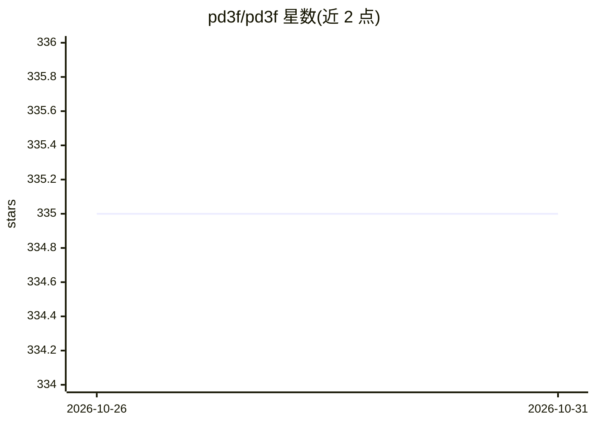

# pd3f/pd3f

⭐ 335 · Python · AGPL-3.0 · 推送 2026-10-27 · [GitHub](https://github.com/pd3f/pd3f) · [官网](https://pd3f.com) · 组织维护

**自托管本地优先的 PDF 文本提取流水线，重建连续文本**

基于 Docker Compose 的 PDF 文本提取流水线：以 Parsr 输出为起点，经 OCRmyPDF(Tesseract) 识别扫描件、Camelot/Tabula 抽取表格，再由 pd3f-core 用语言模型去除连字符与换行、重建原始连续文本。提供 Web GUI 与 Flask API，任务经 Redis 队列由 worker 执行。支持德、英、西、法、意五种语言，尤其面向德语长词场景。README 自标注为实验性项目；首次启动需下载约 10 GB 镜像。

## 筛选速览

| 维度 | 判定 | 备注 |
|---|---|---|
| AI 角色 | `ai-native` | 本体是模型或模型工具 |
| 许可风险 | `viral` | AGPL-3.0 |
| 部署形态 | `self-host` | docker 或自建部署 |
| 模型依赖 | — | README 未给出锁定关系 |
| 硬件要求 | — | 无带数字的原话,不猜 |
| 安装摩擦 | `low` | 无编译、无系统依赖或容器化 |
| 成熟度 | `idea` | |

## 能力要点

- OCRmyPDF 扫描件识别与 Camelot/Tabula 表格抽取
- pd3f-core 用语言模型重建原始连续文本（去连字符/换行/空格）
- Web GUI + Flask API + Redis 任务队列的微服务架构
- 镜像发布 amd64 与 arm64，Parsr 在 ARM 上以模拟运行且较慢

## 适用场景

- 自托管地批量提取 PDF 文本供下游处理
- 处理德语等长词语言的信函与官方文件
- 通过 API 将扫描 PDF OCR 并重建为连续文本

## 场景标签

`OCR` `文档解析` · 领域:知识与检索

## 证据(README 行号)

> L5: `pd3f` is a PDF **text extraction** pipeline that is self-hosted, local-first and Docker-based.
> L14: It uses language models to guess how the original text looked like.

## 星数曲线

2026-10-26 335 → 2026-10-31 335（+0）

---
*卡片 v1 · prompt 1.4 · 生成 2026-10-27 · 置信度 high · 依据 README sha `10f7c51de478` · [字段定义](../../DATASET.md)*
