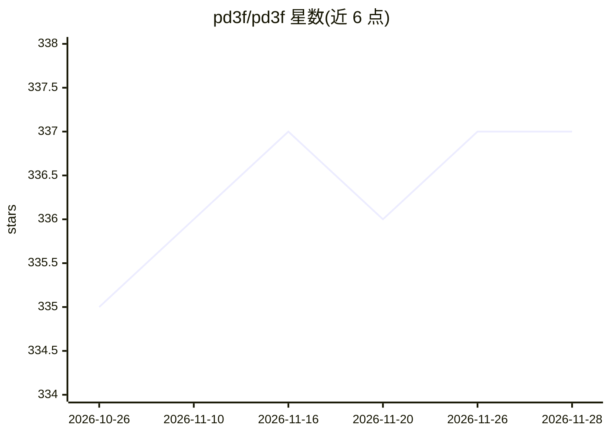

# pd3f/pd3f

⭐ 337 · Python · AGPL-3.0 · 推送 2026-11-10 · [GitHub](https://github.com/pd3f/pd3f) · [官网](https://pd3f.com) · 个人维护

**自托管 PDF 文本提取库：还原段落、去页眉页脚、补 OCR**

从 PDF 提取连续文本的 Python 库、命令行工具与自托管 Web 应用：按间距、字体与文本块将行重组为段落，去除行尾连字符，移除重复页眉页脚，归集脚注，并对无文本层的页面经 OCRmyPDF/Tesseract 做 OCR。每个歧义决策记录到 decisions.json 供复核；默认用固定规则裁决，可选 Flair 字符语言模型作为 scorer。默认语言为德语，另支持英西法意。经 pip 安装或 Docker 镜像运行。

## 筛选速览

| 维度 | 判定 | 备注 |
|---|---|---|
| AI 角色 | `ai-enhanced` | 去掉 AI 部分产品仍成立 |
| 许可风险 | `viral` | AGPL-3.0 |
| 部署形态 | `self-host` | docker 或自建部署 |
| 模型依赖 | — | README 未给出锁定关系 |
| 硬件要求 | — | 无带数字的原话,不猜 |
| 安装摩擦 | `low` | 无编译、无系统依赖或容器化 |
| 成熟度 | — | 结构信号不足 |

## 能力要点

- 段落重建、连字符合并、页眉页脚与脚注处理，每个决策记录到 JSON 日志
- 无文本层页面自动走 OCRmyPDF + Tesseract，页面先摆正再识别
- 三种形态：Python 库、CLI、自托管 Web 应用（含 HTTP API）
- 可选用 Flair 字符语言模型对歧义裁决打分，默认规则即时裁决

## 适用场景

- 批量提取德语信函与公文的连续正文文本
- 把扫描件 PDF 转成可用的纯文本或 Markdown（含表格 CSV）
- 自建一个带 HTTP API 的本地 PDF 文本提取服务

## 场景标签

`文档解析` `OCR` · 领域:知识与检索

## 证据(README 行号)

> L10: pd3f is a Python library, a command line tool and a small web app.
> L121: |`flair`|Flair's forward and backward character language models for the language, via dehyphen, run with numpy|sec

## 星数曲线

2026-10-26 335 → 2026-11-28 337（+2）

---
*卡片 v1 · prompt 1.4 · 生成 2026-11-25 · 置信度 mid · 依据 README sha `e8e863fec391` · [字段定义](../../DATASET.md)*
