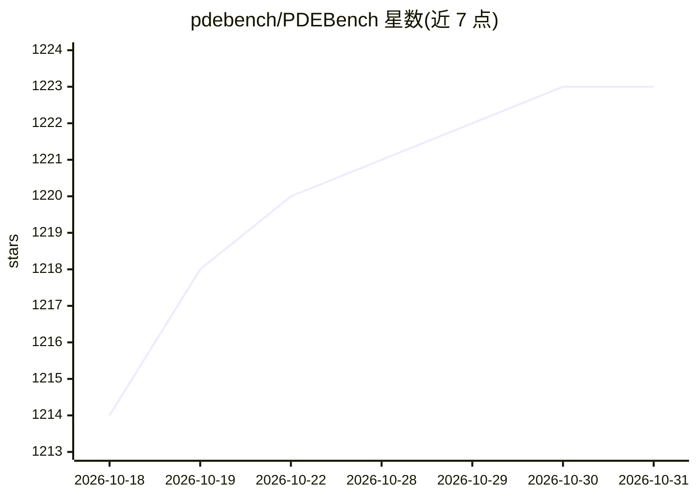

# pdebench/PDEBench

⭐ 1,223 · Python · NOASSERTION · 推送 2026-03-30 · [GitHub](https://github.com/pdebench/PDEBench) · [官网](https://arxiv.org/abs/2210.07182) · 组织维护

**科学机器学习 PDE 基准：数据集生成、下载与基线模型评测**

NeurIPS 2022 论文的配套代码库（SimTech 2023 最佳论文奖），为科学机器学习提供偏微分方程基准：包含数据集生成代码、向数据仓库（DaRUS）上传/下载数据的脚本，以及训练和评测基线模型（FNO、U-Net、PINN）的代码，覆盖正向与逆向问题。官方目标版本为 Python 3.9 / JAX 0.4.11 / PyTorch 1.13.0 / CUDA 11.7，并说明核心组件已验证兼容更新版本。由 NEC 实验室与斯图加特大学等研究者维护。

## 筛选速览

| 维度 | 判定 | 备注 |
|---|---|---|
| AI 角色 | `ai-ecosystem` | LLM/agent 周边工具 |
| 许可风险 | `none` | NOASSERTION |
| 部署形态 | `library` | 以包/库形式分发 |
| 模型依赖 | — | README 未给出锁定关系 |
| 硬件要求 | — | 无带数字的原话,不猜 |
| 安装摩擦 | `medium` | 含编译或系统依赖之一 |
| 成熟度 | — | 结构信号不足 |

## 能力要点

- 提供多种 PDE 的数据生成脚本与 HDF5 数据转换合并流程
- 基线模型 FNO、U-Net、PINN 的训练/评测/指标计算脚本
- 数据集与预训练模型通过 DaRUS DOI 发布
- 支持正向与逆向问题训练（run_forward_1D.sh / run_inverse.sh）

## 适用场景

- 为科学 ML 模型提供 PDE 基准数据集与统一评测
- 复现论文中的 FNO/U-Net/PINN 基线结果
- 生成自定义初始/边界条件的 PDE 训练数据

## 场景标签

`模型评测` `科研工具` · 领域:评测与运维

## 证据(README 行号)

> L10: PDEBench provides a diverse and comprehensive set of benchmarks for scientific
> L13: download the datasets from the data repository, as well as to train and evaluate
> L261: In this work, we provide three different ML models to be trained and evaluated

## 星数曲线

2026-10-18 1,214 → 2026-10-31 1,223（+9）

---
*卡片 v1 · prompt 1.4 · 生成 2026-10-21 · 置信度 high · 依据 README sha `a06b94f50e68` · [字段定义](../../DATASET.md)*
