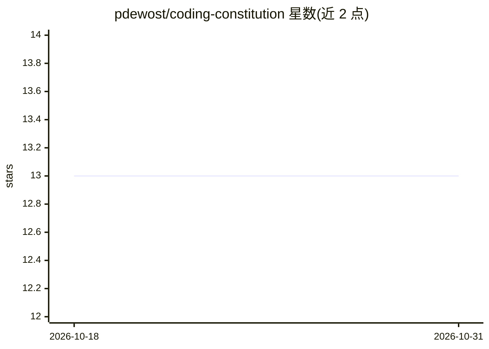

# pdewost/coding-constitution

⭐ 13 · Python · NOASSERTION · 推送 2026-10-29 · [GitHub](https://github.com/pdewost/coding-constitution) · 个人维护

**治理 AI 编程 agent 的宪法与 hook 强制层**

面向使用 AI 编程 agent 的开发者：提供一份已批准的宪法文档（14 条款）加 harness 中立的强制层。策略定义于 spec/POLICY_CORE.md，经薄适配器翻译为 Claude Code hooks：会话冷启动注入上下文（ANCHOR）、每次提示的任务感知提醒（GUARDRAIL）、编辑后语法检查并阻断（COMPILE-GATE）、回合结束验证门（CLOSEOUT-GATE/VERIFY-GATE）、拒绝危险删除命令（DENY 系列）等。README 明示限制：deny-hooks 是纵深防御而非沙箱，无 git hook、无 CI；升级需手工复制文件并用 install_adapters.py 重新武装。

## 筛选速览

| 维度 | 判定 | 备注 |
|---|---|---|
| AI 角色 | `ai-ecosystem` | LLM/agent 周边工具 |
| 许可风险 | `none` | NOASSERTION |
| 部署形态 | `library` | 以包/库形式分发 |
| 模型依赖 | — | README 未给出锁定关系 |
| 硬件要求 | — | 无带数字的原话,不猜 |
| 安装摩擦 | `low` | 无编译、无系统依赖或容器化 |
| 成熟度 | `idea` | |

## 能力要点

- 13 条策略经 harness 中立 spec 翻译为 Claude Code hooks
- COMPILE-GATE 编辑后语法检查并阻断，错误直接回传
- DENY 系列拒绝删除归档/不可逆 AppleScript 等危险命令
- approved list 哈希校验，hook/设置变更被报告为篡改

## 适用场景

- 给 Claude Code 等 AI 编程 agent 加装可执行的治理规则
- 要求 agent 改码后必须运行验证才能结束回合
- 防止 agent 执行不可逆删除命令

## 场景标签

 · 领域:AI 编程代理治理/开发者工具

## 证据(README 行号)

> L4: > A ratified constitution, a harness-neutral enforcement layer, and the
> L62: The policies are defined once in `spec/POLICY_CORE.md` (harness-neutral) and translated by a thin

## 星数曲线

2026-10-18 13 → 2026-10-31 13（+0）

---
*卡片 v1 · prompt 1.4 · 生成 2026-10-31 · 置信度 mid · 依据 README sha `86cd0af8afe9` · [字段定义](../../DATASET.md)*
