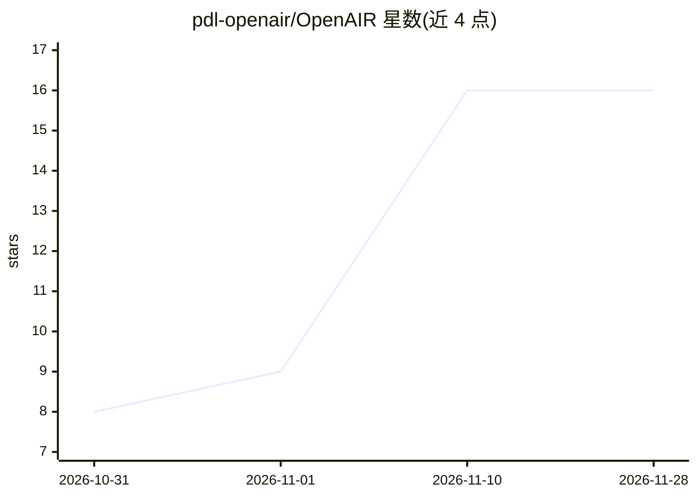

# pdl-openair/OpenAIR

⭐ 16 · Python · Apache-2.0 · 推送 2026-11-10 · [GitHub](https://github.com/pdl-openair/OpenAIR) · [官网](https://pdl-openair.github.io/OpenAIR/) · 组织维护 · 中文 README

**面向科研四阶段闭环的智能体编排平台，材料发现首发场景**

将科研过程建模为问题建模→方案设计→执行验证→洞察生成的四阶段闭环，由 FastAPI 编排运行时统一调度，AI 能力以 200+ 契约化 SKILL.md 形式注册，React 工作台供人确认方案与核验证据链。提供 live/replay 双执行模式，replay 零密钥回放全流程。已验证场景为晶体材料发现（VASP 计算）与 AlN PVD 工艺寻优（干湿闭环四轮反馈）。支持多用户配额、Docker 一键部署与 openair-cli；材料全流程为确定性编排不依赖 LLM 规划器，通用任务规划需真实网关密钥。

## 筛选速览

| 维度 | 判定 | 备注 |
|---|---|---|
| AI 角色 | `ai-ecosystem` | LLM/agent 周边工具 |
| 许可风险 | `permissive` | Apache-2.0 |
| 部署形态 | `desktop` | 安装包/桌面程序 |
| 模型依赖 | — | README 未给出锁定关系 |
| 硬件要求 | — | 无带数字的原话,不猜 |
| 安装摩擦 | `low` | 无编译、无系统依赖或容器化 |
| 成熟度 | — | 结构信号不足 |

## 能力要点

- 四阶段科研编排运行时（FastAPI + PostgreSQL + durable worker）
- 200+ Markdown 契约化 skill，registry 注册、可独立测试与回放
- 证据链全程可追溯，干湿实验在同一流水线闭环
- replay 模式零密钥回放全流程；openair-cli 一键部署

## 适用场景

- 我想让 AI 智能体跑完材料发现从建模到验证的完整科研流程
- 科研团队在计算验证与实验制备间做闭环迭代并追溯证据
- 零密钥体验平台全流程后再接入真实模型网关与超算

## 场景标签

`科研工具` `Agent 框架` · 领域:Agent 开发

## 证据(README 行号)

> L45: 科研任务的痛点是**周期长、工具分散、证据难追溯、实验反馈利用不足**。OpenAIR 将科研过程建模为四阶段生命周期，由平台统一编排，AI 在每个阶段以「skill」形式提供能力，人始终可以在工作台上确认方案、跟踪进度、核验证据
> L49: - 🔁 **四阶段过程模型** —— problem_modeling → solution_design → execution_validation → insight_generation；是组织框架而非固定串行流水线，新的
> L76: - **编排运行时**（`services/api`）：FastAPI，四阶段生命周期编排、PostgreSQL 持久化、durable worker 派发

## 星数曲线

2026-10-31 8 → 2026-11-28 16（+8）

---
*卡片 v1 · prompt 1.4 · 生成 2026-11-18 · 置信度 mid · 依据 README sha `133118bb8a30` · [字段定义](../../DATASET.md)*
