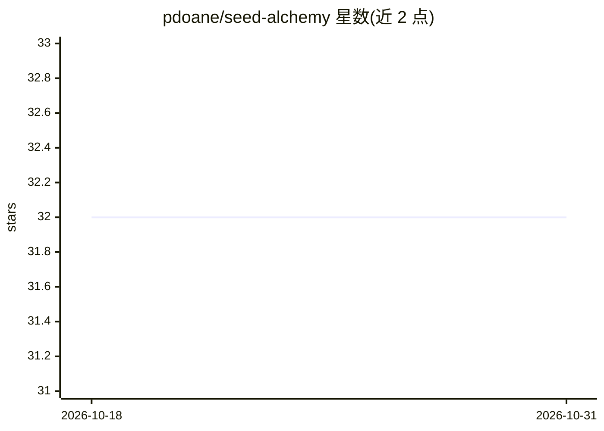

# pdoane/seed-alchemy

⭐ 32 · TypeScript · Apache-2.0 · 推送 2026-04-23 · [GitHub](https://github.com/pdoane/seed-alchemy) · 个人维护

**Stable Diffusion 图像生成的 Web 前端与后端服务器**

面向 Stable Diffusion 模型（1.x/2.x/SDXL）的图像生成应用：前端 UI 加后端服务器架构，支持文生图、图生图、内绘、ControlNet、LoRA、Textual Inversion、高分辨率修复、ESRGAN 放大、GFPGAN 面部修复、Prompt 生成器与潜空间实时预览。安装需先具备 Python 与 Node.js，通过 install.sh/install.bat 安装依赖，后端以 run 脚本启动，前端支持 npm 开发运行与 Electron 桌面构建。

## 筛选速览

| 维度 | 判定 | 备注 |
|---|---|---|
| AI 角色 | `ai-native` | 本体是模型或模型工具 |
| 许可风险 | `permissive` | Apache-2.0 |
| 部署形态 | `None` |  |
| 模型依赖 | — | README 未给出锁定关系 |
| 硬件要求 | — | 无带数字的原话,不猜 |
| 安装摩擦 | `low` | 无编译、无系统依赖或容器化 |
| 成熟度 | — | 结构信号不足 |

## 能力要点

- 支持 Stable Diffusion 1.x/2.x/SDXL 的文生图、图生图与内绘
- ControlNet、LoRA、Textual Inversion 及 Compel 提示词加权
- ESRGAN 放大与 GFPGAN 面部修复
- 提供 Electron 桌面端构建方式

## 适用场景

- 在本地通过 Web UI 使用 Stable Diffusion 生成图像
- 使用 LoRA/ControlNet 等扩展控制生成结果
- 对生成图像进行放大与面部修复

## 场景标签

`图像生成` · 领域:内容生成

## 证据(README 行号)

> L3: # SeedAlchemy: AI Image Generation
> L9: - Stable Diffusion 1.x, 2.x, SDXL

## 星数曲线

2026-10-18 32 → 2026-10-31 32（+0）

---
*卡片 v1 · prompt 1.4 · 生成 2026-10-25 · 置信度 high · 依据 README sha `6352fbdaad4d` · [字段定义](../../DATASET.md)*
