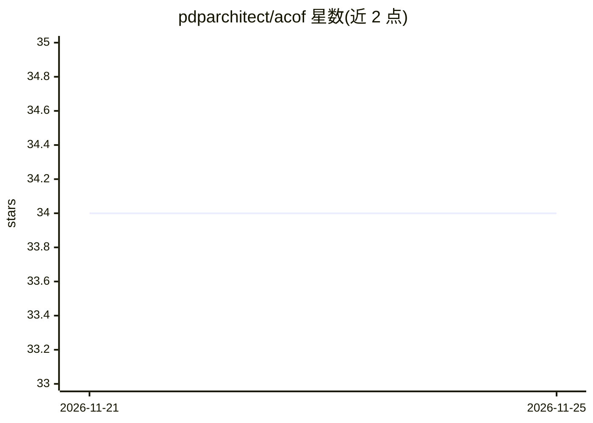

# pdparchitect/acof

⭐ 34 · Go · MIT · 推送 2026-11-20 · [GitHub](https://github.com/pdparchitect/acof) · 个人维护

**给安全研究者的自主漏洞挖掘 AI harness（单 Go 二进制）**

面向漏洞研究、漏洞挖掘与源码审计的 AI harness，以单个静态 Go 二进制分发。用户给出目标（目标、完成标准、交战规则），内置的 zot 自主引擎按研究者方式工作：枚举、读代码、探测、串联发现，返回带证据的具体发现。引擎直连任意 OpenAI 兼容 provider，使用用户自己的 key，无托管服务、无遥测；每次运行记录可续跑的会话，默认 zai provider 跑 glm-5.2。仅限对自有或获授权的系统使用。

## 筛选速览

| 维度 | 判定 | 备注 |
|---|---|---|
| AI 角色 | `ai-native` | 本体是模型或模型工具 |
| 许可风险 | `permissive` | MIT |
| 部署形态 | `desktop` | 安装包/桌面程序 |
| 模型依赖 | local-ok | 支持本地模型 |
| 硬件要求 | — | 无带数字的原话,不猜 |
| 安装摩擦 | `low` | 无编译、无系统依赖或容器化 |
| 成熟度 | — | 结构信号不足 |

## 能力要点

- 单静态二进制，跨平台，无需安装依赖
- 目标文件驱动：队列、批量、流式与完成台账（ledger）
- 按需技能目录，agent 运行时拉取所需 playbook
- 会话可续跑（--resume）并以 digest 收尾

## 适用场景

- 对自己授权的代码库做注入与鉴权绕过审计
- 持续运行的漏洞挖掘任务队列与断点续跑
- 在隔离主机上无人值守执行安全测试任务

## 场景标签

`网络安全` · 领域:学习与行业

## 证据(README 行号)

> L5: Acof is an AI bug-hunting harness for vulnerability research, bug hunting and
> L10: back them. The autonomous engine (zot) runs
> L11: inside the binary and talks straight to any OpenAI-compatible provider with your

## 星数曲线

2026-11-21 34 → 2026-11-25 34（+0）

---
*卡片 v1 · prompt 1.4 · 生成 2026-11-21 · 置信度 high · 依据 README sha `e4db60016638` · [字段定义](../../DATASET.md)*
