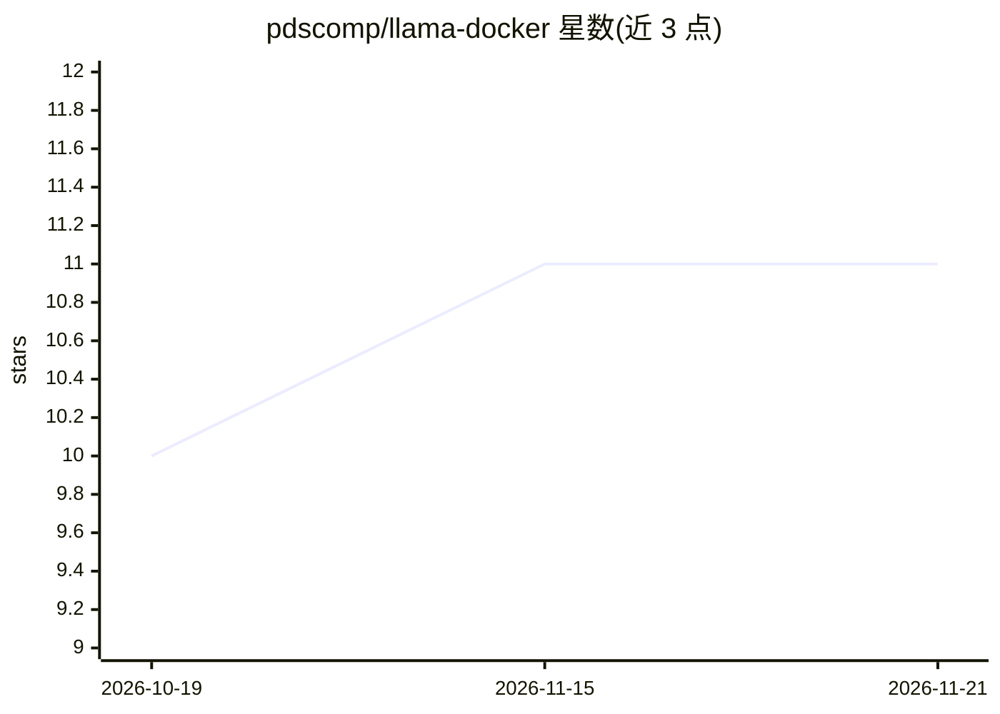

# pdscomp/llama-docker

⭐ 11 · Dockerfile · MIT · 推送 2026-06-25 · [GitHub](https://github.com/pdscomp/llama-docker) · 个人维护

**Docker 模板：以 router 模式运行 llama.cpp 推理服务器**

一个 Docker 模板仓库，用于在 router 模式下运行 llama.cpp 的 llama-server，支持 NVIDIA CUDA 与 AMD Vulkan GPU 加速。前置要求用户自行 clone 并构建 turboquant 支持的 llama.cpp fork（TheTom 或 buun 变体），通过 compose.yml 挂载 models 目录与 config.ini 配置模型预设、KV cache 量化策略与 GPU offload 参数，经 ./rc.start 启动后在 8080 端口提供 web UI 与 HTTP API。针对 24GB+ VRAM 显卡提供预设调优配置，支持最长 262,144 token 上下文。AMD 部分作者已测试但尚未并入仓库。

## 筛选速览

| 维度 | 判定 | 备注 |
|---|---|---|
| AI 角色 | `ai-ecosystem` | LLM/agent 周边工具 |
| 许可风险 | `permissive` | MIT |
| 部署形态 | `self-host` | docker 或自建部署 |
| 模型依赖 | local-ok | 支持本地模型 |
| 硬件要求 | `gpu-24g` | |
| 安装摩擦 | `low` | 无编译、无系统依赖或容器化 |
| 成熟度 | — | 结构信号不足 |

## 能力要点

- router 模式管理与加载多个模型，同时服务一个
- TurboQuant KV cache 量化（q8_0/turbo4/turbo3 组合），支持最长 262,144 token 上下文
- NVIDIA CUDA 与 AMD Vulkan 双后端，含 RTX 3090 实测配置
- config.ini 统一管理模型预设、端口与性能参数

## 适用场景

- 在 Docker 中部署本地 llama.cpp 推理服务器供 agent 或应用调用
- 在 24GB VRAM 显卡上运行 Qwen/Gemma 级别的大模型
- 按 KV cache 量化策略权衡显存占用与吞吐

## 场景标签

`推理引擎` `模型量化` · 领域:训练与推理

## 证据(README 行号)

> L1: # llama-docker: Router Mode LLM Server with NVIDIA CUDA & AMD Vulkan Support
> L3: A Docker-based template for running **llama.cpp llama-server** in router mode with support for NVIDIA CUDA (NVIDIA G
> L10: - **Router Mode**: Efficiently manage and load multiple models, serving one at a time with full context window

## 星数曲线

2026-10-19 10 → 2026-11-21 11（+1）

---
*卡片 v1 · prompt 1.4 · 生成 2026-11-18 · 置信度 high · 依据 README sha `d7cc82d09e59` · [字段定义](../../DATASET.md)*
