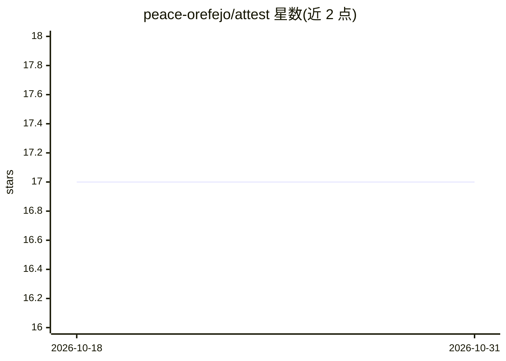

# peace-orefejo/attest

⭐ 17 · Python · MIT · 推送 2026-10-30 · [GitHub](https://github.com/peace-orefejo/attest) · [官网](https://pypi.org/project/agent-attest/) · 个人维护

**基于工具真实输出的 AI agent 评测库，逐条核验答案声明**

Python 评测库（pip 包 agent-attest），面向开发 AI agent 的开发者：读取一次运行的轨迹（用户提问、工具调用与返回、最终答案），将答案拆分为单条声明并对照工具真实输出核验，检查编造事实、工具误用、隐藏指令注入与偏离任务四类问题，输出带误差区间的分数。评测模型可选 Anthropic/OpenAI/Gemini，判定被约束为单条声明对单条证据，不看 agent 叙述。只读设计，不运行用户工具；确定性策略规则可完全离线。

## 筛选速览

| 维度 | 判定 | 备注 |
|---|---|---|
| AI 角色 | `ai-ecosystem` | LLM/agent 周边工具 |
| 许可风险 | `permissive` | MIT |
| 部署形态 | `library` | 以包/库形式分发 |
| 模型依赖 | — | README 未给出锁定关系 |
| 硬件要求 | — | 无带数字的原话,不猜 |
| 安装摩擦 | `low` | 无编译、无系统依赖或容器化 |
| 成熟度 | `idea` | |

## 能力要点

- 逐条声明对照工具真实输出的证据核验
- 四项检查：编造事实、工具使用、提示注入、任务偏离
- 分数附带误差区间，区分真实改进与随机噪声
- 只读设计：不运行工具、不调用 agent，仅评测需 API key

## 适用场景

- 评测 agent 回答是否与工具实际返回一致
- 检测数据中的隐藏指令注入是否影响了 agent
- 在 CI/自动化中用 --json 输出做自动评分

## 场景标签

`模型评测` `LLM 可观测性` · 领域:评测与运维

## 证据(README 行号)

> L3: **A reality-checker for AI agents.** It grades an agent's answer against what its tools
> L21: attest takes the opposite approach: **never trust what the agent says it did — check it
> L43: It also gives you a score **with error bars**, so you can tell a real improvement from

## 星数曲线

2026-10-18 17 → 2026-10-31 17（+0）

---
*卡片 v1 · prompt 1.4 · 生成 2026-10-30 · 置信度 high · 依据 README sha `789ac898573a` · [字段定义](../../DATASET.md)*
