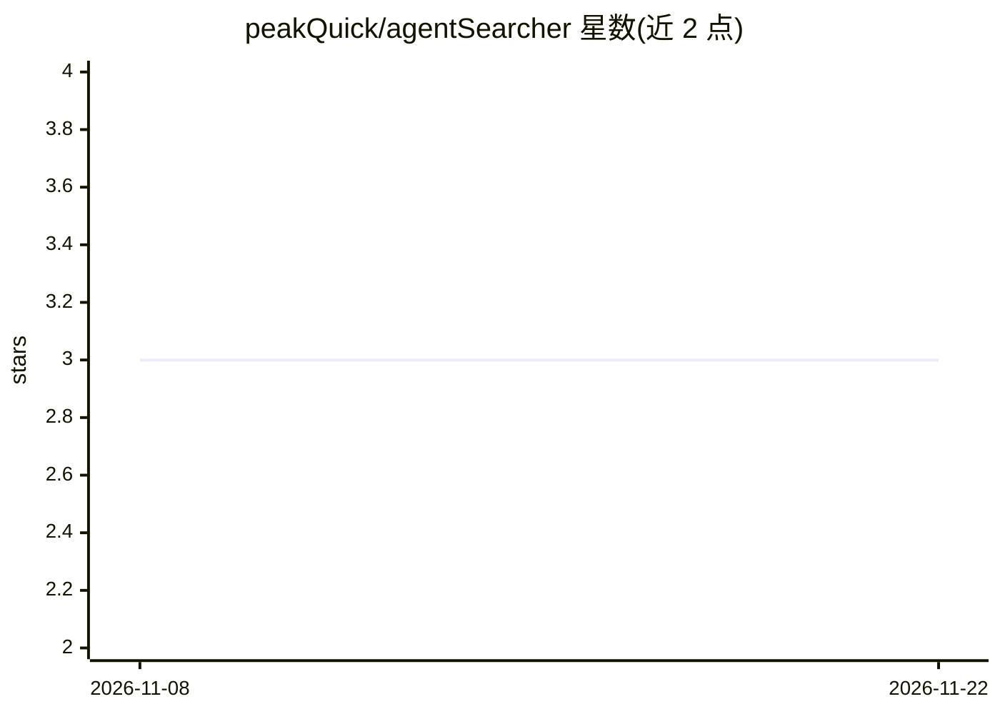

# peakQuick/agentSearcher

⭐ 3 · Python · AGPL-3.0 · 推送 2026-10-27 · [GitHub](https://github.com/peakQuick/agentSearcher) · 个人维护

**自托管 MCP 搜索服务器：为 AI agent 提供网页搜索/抽取/爬取**

单进程 Python 服务，面向使用 AI agent 的开发者：聚合多个搜索引擎查询、抓取网页（JS 页经 headless Chromium 渲染、PDF 读文本层）、清洗并用 BM25 与多语言 cross-encoder（ONNX int8, CPU）重排，返回适配小上下文窗口的片段。以 MCP server（stdio/HTTP）、Tavily 兼容 HTTP API 与 CLI 三种形式提供，带浏览器 dashboard。默认阻止 localhost 与私网（SSRF 防护），结果缓存 15 分钟，空闲 2 分钟后卸载模型与浏览器。

## 筛选速览

| 维度 | 判定 | 备注 |
|---|---|---|
| AI 角色 | `ai-ecosystem` | LLM/agent 周边工具 |
| 许可风险 | `viral` | AGPL-3.0 |
| 部署形态 | `self-host` | docker 或自建部署 |
| 模型依赖 | — | README 未给出锁定关系 |
| 硬件要求 | `cpu-ok` | |
| 安装摩擦 | `low` | 无编译、无系统依赖或容器化 |
| 成熟度 | — | 结构信号不足 |

## 能力要点

- MCP server 提供 web_search/web_extract/web_crawl/web_map 四个工具
- Tavily 兼容 API 端点，现有客户端仅需改 base URL，经 tavily-python 契约测试
- CPU-only 运行，含 SSRF 防护、去重与每域名结果上限
- pipx 安装或 docker compose 运行，零配置启动

## 适用场景

- 给支持 MCP 的 agent 客户端接入本地网页搜索工具
- 以 Tavily 兼容接口自托管替换现有检索端点
- 为 RAG 流程抓取并重排网页片段
- 命令行快速搜索、抽取或映射站点结构

## 场景标签

`网页抓取` `RAG` · 领域:效率与自动化

## 证据(README 行号)

> L10: An agent that works with the web needs to find pages, read them (including JavaScript pages and PDFs) and sometimes
> L25: - MCP server (stdio, or streamable HTTP at `/mcp` on the API port) with the tools `web_search`, `web_extract`, `web

## 星数曲线

2026-11-08 3 → 2026-11-22 3（+0）

---
*卡片 v1 · prompt 1.4 · 生成 2026-11-21 · 置信度 high · 依据 README sha `b62d43a60383` · [字段定义](../../DATASET.md)*
