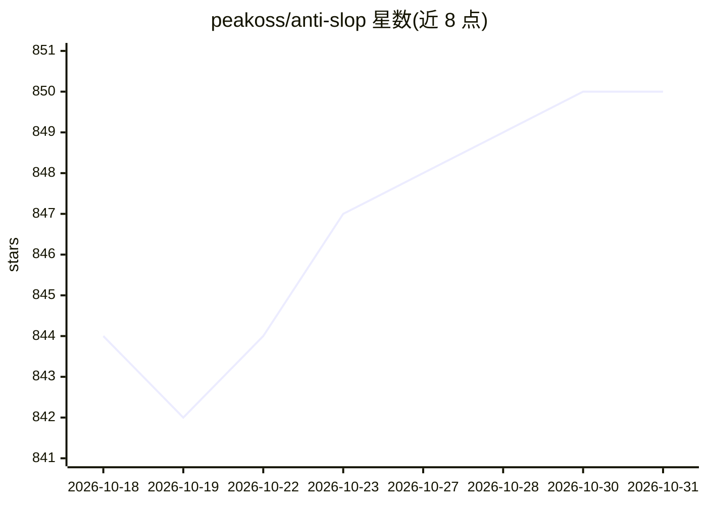

# peakoss/anti-slop

⭐ 850 · TypeScript · AGPL-3.0 · 推送 2026-04-15 · [GitHub](https://github.com/peakoss/anti-slop) · 组织维护

**检测并自动关闭低质量与 AI 垃圾 PR 的 GitHub Action**

面向开源维护者的 GitHub Action：对每个 PR 运行 34 条规则检查，覆盖分支、PR 体积、标题、描述、模板、提交信息、文件变更、用户信号与贡献者历史（账号年龄、fork 频率、合并率等），失败数达到阈值（默认 4，可配 1-25）时执行关闭、锁定、评论或打标签等动作。提供 57 个配置项与默认值，Owners/Members/Collaborators 默认豁免。当前为 v0，README 声明 v1.0.0 前可能有破坏性变更，建议固定版本号。规则来源于 130+ 条人工审阅的 AI slop PR；README 声明不惩罚真正的 AI 辅助贡献。

## 筛选速览

| 维度 | 判定 | 备注 |
|---|---|---|
| AI 角色 | `ai-enhanced` | 去掉 AI 部分产品仍成立 |
| 许可风险 | `viral` | AGPL-3.0 |
| 部署形态 | `None` |  |
| 模型依赖 | — | README 未给出锁定关系 |
| 硬件要求 | — | 无带数字的原话,不猜 |
| 安装摩擦 | `low` | 无编译、无系统依赖或容器化 |
| 成熟度 | `idea` | |

## 能力要点

- 34 条检查规则，覆盖 PR 元数据、文件变更与贡献者历史信号
- 57 个配置项，max-failures 阈值（1-25）控制误报敏感度
- 失败时自动关闭/锁定 PR、评论或增删标签
- Owner/Member/Collaborator 默认零配置豁免

## 适用场景

- 开源项目维护者在评审队列前拦截低质量或 AI 生成的垃圾 PR
- 通过账号年龄、fork 频率、合并率等信号过滤可疑新贡献者
- 按仓库规范定制分支、标题、提交信息与文件路径检查

## 场景标签

 · 领域:开发工具/开源治理

## 证据(README 行号)

> L3: A GitHub Action that detects and automatically closes low-quality and AI slop PRs. It ships with **34 check rules** 
> L17: - **Battle-tested rules:** All 31 checks are derived from patterns identified across 130+ manually reviewed AI slop
> L19: - **Anti-slop, not anti-AI:** Genuinely good AI-assisted contributions are not penalized.

## 星数曲线

2026-10-18 844 → 2026-10-31 850（+6）

---
*卡片 v1 · prompt 1.4 · 生成 2026-10-21 · 置信度 high · 依据 README sha `821754cdcb6d` · [字段定义](../../DATASET.md)*
