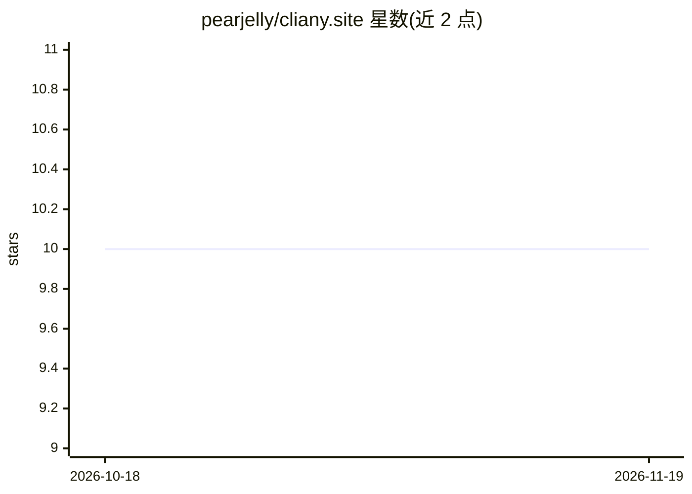

# pearjelly/cliany.site

⭐ 10 · Python · MIT · 推送 2026-11-16 · [GitHub](https://github.com/pearjelly/cliany.site) · [官网](https://www.cliany.site) · 个人维护 · 中文 README

**把重复浏览器操作录制成可复用 CLI 命令的自动化框架**

cliany-site 通过 Chrome CDP 观察页面 AXTree，借助 LLM（Claude/GPT-4o）理解页面语义并生成针对特定站点的 Python CLI 命令，再以结构化 JSON 重放执行。机制包括零注入探索、AXTree 快照对比修复、Fernet 加密会话存储、AST 安全校审与 YAML 工作流编排；支持 pip 安装，提供 Python SDK 与 HTTP API，面向需要将浏览器流程自动化的开发者。

## 筛选速览

| 维度 | 判定 | 备注 |
|---|---|---|
| AI 角色 | `ai-native` | 本体是模型或模型工具 |
| 许可风险 | `permissive` | MIT |
| 部署形态 | `library` | 以包/库形式分发 |
| 模型依赖 | locked-api |  |
| 硬件要求 | — | 无带数字的原话,不猜 |
| 安装摩擦 | `low` | 无编译、无系统依赖或容器化 |
| 成熟度 | `idea` | |

## 能力要点

- 通过 Chrome CDP 捕获 AXTree，无需脚本注入即可探索页面
- LLM 自动生成站点专属 Python CLI 命令并重放为结构化 JSON
- AXTree 快照对比的选择器热修复，无需重新探索
- 支持 headless、远程 CDP 与 Docker 场景，含 YAML 多步工作流编排

## 适用场景

- 把每天重复的登录、查询、表单操作固化成一条 CLI 命令
- 对 Jira、Confluence、Jenkins 等站点做只读数据提取
- 团队内打包分发站点适配器，共享自动化能力

## 场景标签

`浏览器自动化` `工作流自动化` `代码生成` · 领域:效率与自动化

## 证据(README 行号)

> L16: cliany-site observes a browser workflow through Chrome CDP, uses an LLM to turn it into a site-specific command, an
> L51: - **Zero-Intrusion Exploration** — Chrome CDP captures page AXTree without script injection.
> L52: - **LLM-Driven Code Generation** — Claude / GPT-4o understands page semantics and generates Python CLI commands aut

## 星数曲线

2026-10-18 10 → 2026-11-19 10（+0）

---
*卡片 v1 · prompt 1.4 · 生成 2026-11-19 · 置信度 high · 依据 README sha `8efb8685babc` · [字段定义](../../DATASET.md)*
