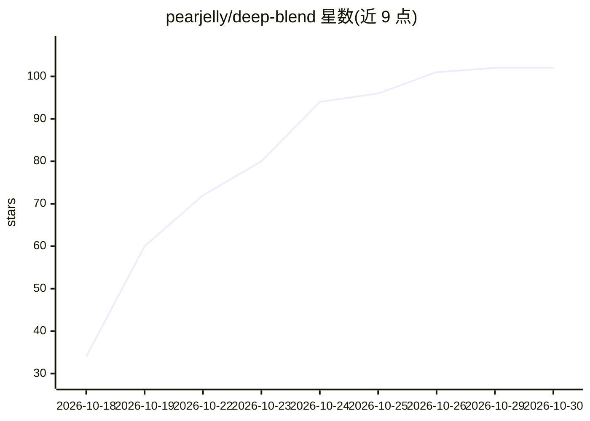

# pearjelly/deep-blend

⭐ 102 · JavaScript · MIT · 推送 2026-10-27 · [GitHub](https://github.com/pearjelly/deep-blend) · [官网](https://github.com/pearjelly/deep-blend#quick-start) · 个人维护 · 中文 README

**在 DeepSeek Harness 中构建与渲染 Blender 产品场景的插件**

DeepBlend Studio 是一个 DSH（DeepSeek Harness）插件，在宿主会话内提供 Blender 产品场景的创建、编辑与渲染工作流：以可编辑配方或导入 glTF/GLB/OBJ 模型起步，在 Lighttable 工作台中调整形状、材质、相机与灯光，每次接受的修改生成不可变修订，最终渲染 PNG 帧并编码 MP4。Agent 预设提供 19 个模型可见工具，覆盖场景、资产、预览、视觉审阅与交付；SceneSpec 是场景真源，.blend 为编译产物。需本机安装 Blender，MP4 编码需 FFmpeg；不替代 Blender 桌面编辑器。文档以中文为主。

## 筛选速览

| 维度 | 判定 | 备注 |
|---|---|---|
| AI 角色 | `ai-ecosystem` | LLM/agent 周边工具 |
| 许可风险 | `permissive` | MIT |
| 部署形态 | `library` | 以包/库形式分发 |
| 模型依赖 | locked-api |  |
| 硬件要求 | — | 无带数字的原话,不猜 |
| 安装摩擦 | `medium` | 含编译或系统依赖之一 |
| 成熟度 | — | 结构信号不足 |

## 能力要点

- Agent 预设提供 19 个模型可见工具（场景/资产/预览/视觉审阅/交付）
- SceneSpec 为真源、.blend 为编译产物，场景可从声明输入重建
- 修订历史不可变，渲染任务支持取消、恢复与帧校验
- 支持 glTF/GLB/OBJ 模型导入与 PNG/MP4 交付

## 适用场景

- 通过对话让 agent 生成并迭代 Blender 产品场景
- 在图形工作台中用配方快速搭建可渲染的产品展示
- 对比不同修订的渲染结果并导出图像或视频

## 场景标签

 · 领域:3D 建模/渲染工具

## 证据(README 行号)

> L9:  Your Blender studio, inside DeepSeek Harness.
> L126: The agent preset provides **19 model-visible tools** for scenes, assets, previews, visual review and delivery.
> L204: The workbench gallery, editing controls and local renders can be used directly. Agent conversation and model-based

## 星数曲线

2026-10-18 34 → 2026-10-30 102（+68）

---
*卡片 v1 · prompt 1.4 · 生成 2026-10-23 · 置信度 high · 依据 README sha `e5ce17187e06` · [字段定义](../../DATASET.md)*
