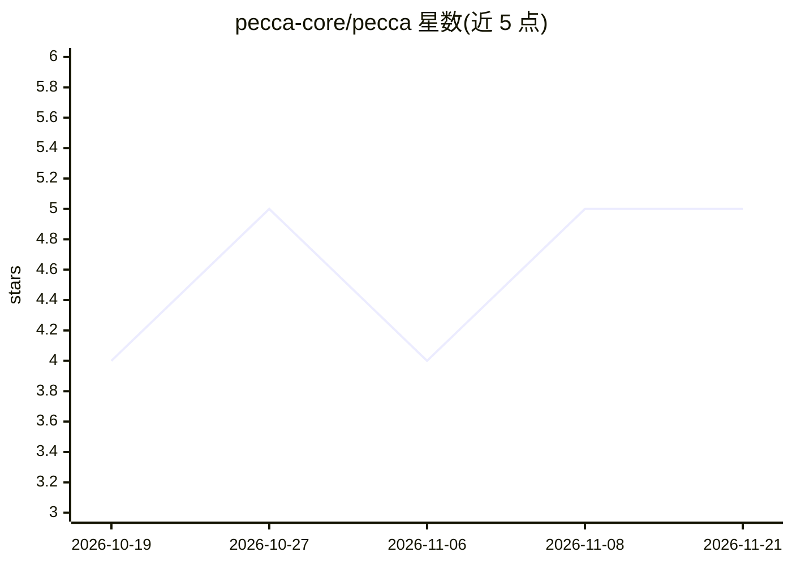

# pecca-core/pecca

⭐ — · [GitHub]() · 个人维护

**将重复 LLM 调用替换为可审计小型 ML 模型的治理工具**

面向在流水线中反复调用 LLM 且输出为固定标签的团队：Pecca 从已记录的 LLM 输出日志中识别可封闭集任务（分类/回归），训练候选小模型（TF-IDF、multilingual-e5+线性头、可选 XLM-R 微调等）并交叉验证择优，经校准阈值后以 shadow 模式并行运行，通过治理门禁与审批后转为 live，置信度低于阈值时回落到原 LLM。每个版本生成审计包（血统、混淆矩阵、审批、漂移历史）。以 Python 包发布，PyPI 安装，需 Python 3.11-3.13。

## 筛选速览

| 维度 | 判定 | 备注 |
|---|---|---|
| AI 角色 | `ai-ecosystem` | LLM/agent 周边工具 |
| 许可风险 | `permissive` | — |
| 部署形态 | `library` | 以包/库形式分发 |
| 模型依赖 | — | README 未给出锁定关系 |
| 硬件要求 | — | 无带数字的原话,不猜 |
| 安装摩擦 | `low` | 无编译、无系统依赖或容器化 |
| 成熟度 | `idea` | |

## 能力要点

- Record → Shadow → Live 三阶段替换流程，LLM 保留为回落通道
- 模型竞赛机制：候选模型在相同交叉验证切分上训练，按实测指标择优
- 六项治理原语（gates/approvals/evidence/retention/schedule/controls）经 pecca.yaml 配置
- 提供 MCP server（pecca mcp serve）与 OpenTelemetry spans

## 适用场景

- 把每类请求只返回固定标签的 LLM 调用换成 CPU 小模型
- 在金融合规场景下为模型上线配置门禁与审批留痕
- 为已上线的替代模型持续做漂移复查与再验证

## 场景标签

`MLOps` · 领域:训练与推理

## 证据(README 行号)

> L11: Pecca finds the LLM calls in your pipeline that only ever return a fixed label, trains a CPU model on your logged o
> L69: - **Fit in, don't compete.** Models live in your registry (MLflow/Unity Catalog), decisions are OpenTelemetry spans
> L75: Not an LLM gateway, a prompt tool, an evaluation harness, a feature store or a hosted service. It does not call any

## 星数曲线

2026-10-19 4 → 2026-11-21 5（+1）

---
*卡片 v1 · prompt 1.4 · 生成 2026-11-21 · 置信度 high · 依据 README sha `f43d917f7cad` · [字段定义](../../DATASET.md)*
