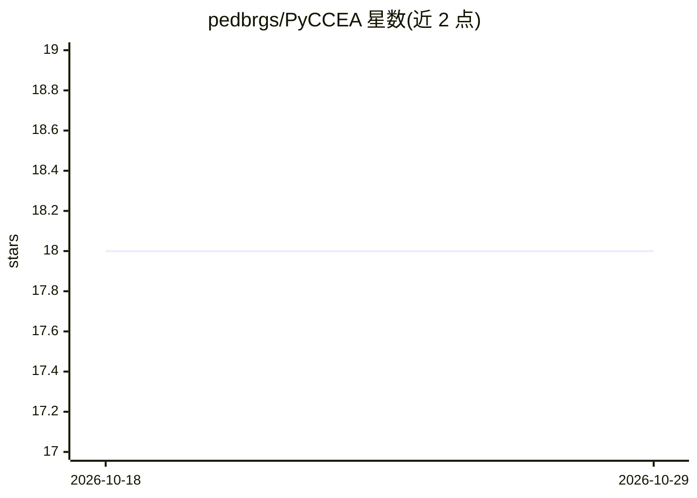

# pedbrgs/PyCCEA

⭐ 18 · Python · MIT · 推送 2026-07-06 · [GitHub](https://github.com/pedbrgs/PyCCEA) · [官网](https://pedbrgs.github.io/PyCCEA/) · 个人维护

**面向高维数据特征选择的合作协同进化算法 Python 库**

作为博士研究一部分开发的开源 Python 包，提供合作协同进化（CCEA）策略用于大规模、高维问题的特征选择，框架采用模块化的分解式方法（如带随机特征分组的 CCFSRFG1）。用户通过 DataLoader 加载数据，从 .toml 文件配置数据集与算法，运行优化后以 best_context_vector 二进制数组输出选中的特征子集；自定义数据集需符合 .parquet 输入模式（含 label 列）。自述为进行中的项目，要求 Python ≥ 3.10，配有文档与引用论文。

## 筛选速览

| 维度 | 判定 | 备注 |
|---|---|---|
| AI 角色 | `ai-native` | 本体是模型或模型工具 |
| 许可风险 | `permissive` | MIT |
| 部署形态 | `library` | 以包/库形式分发 |
| 模型依赖 | — | README 未给出锁定关系 |
| 硬件要求 | — | 无带数字的原话,不猜 |
| 安装摩擦 | `low` | 无编译、无系统依赖或容器化 |
| 成熟度 | `idea` | |

## 能力要点

- 提供合作协同进化算法（如 CCFSRFG1）做特征选择
- 模块化、基于分解的框架设计
- 支持 .toml 配置与 .parquet 自定义数据集输入
- 输出二进制特征子集（best_context_vector）

## 适用场景

- 高维数据集上的特征选择与降维
- 科研中复现或对比合作协同进化特征选择算法
- 作为特征选择组件接入监督学习（分类/回归）流程

## 场景标签

 · 领域:机器学习/特征工程

## 证据(README 行号)

> L12: PyCCEA is an open-source package developed as part of ongoing doctoral research. It provides cooperative co-evoluti
> L34: This quickstart demonstrates how to use the CCFSRFG1 algorithm — a CCEA variant with random feature grouping — to p

## 星数曲线

2026-10-18 18 → 2026-10-29 18（+0）

---
*卡片 v1 · prompt 1.4 · 生成 2026-10-29 · 置信度 high · 依据 README sha `7b1c8112adac` · [字段定义](../../DATASET.md)*
