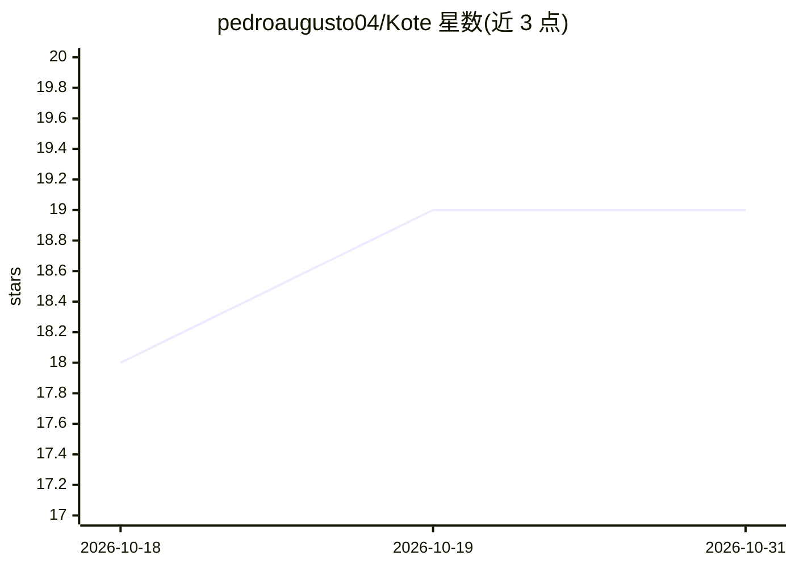

# pedroaugusto04/Kote

⭐ 19 · TypeScript · NOASSERTION · 推送 2026-10-26 · [GitHub](https://github.com/pedroaugusto04/Kote) · [官网](https://pedro-duarte.ddns.net/kote/) · 个人维护

**自动捕获 AI 会话与开发上下文的开发者记忆层**

后台运行的开发者记忆系统：通过 VS Code 扩展自动记录本地 AI 会话（Antigravity/Codex/Claude Code 等）与代码片段，GitHub 集成分析提交 diff 并在 PR 中注入历史决策，WhatsApp/Telegram 可记录语音（转录）与图片笔记，语义搜索以自然语言检索过往决策。CodeLens 在编辑器内展示文件相关知识与代码来源时间线。定位为服务人类开发者的记忆库，不自动注入 agent prompt；通过 MCP 服务器供 AI 助手检索。提供托管服务与 Docker Compose 自托管（依赖 Supabase）。

## 筛选速览

| 维度 | 判定 | 备注 |
|---|---|---|
| AI 角色 | `ai-enhanced` | 去掉 AI 部分产品仍成立 |
| 许可风险 | `none` | NOASSERTION |
| 部署形态 | `self-host` | docker 或自建部署 |
| 模型依赖 | — | README 未给出锁定关系 |
| 硬件要求 | — | 无带数字的原话,不猜 |
| 安装摩擦 | `low` | 无编译、无系统依赖或容器化 |
| 成熟度 | — | 结构信号不足 |

## 能力要点

- VS Code 扩展自动同步本地 AI CLI 会话并保存代码片段为笔记
- CodeLens 展示文件历史决策与代码来源时间线（Ctrl+Shift+E）
- GitHub 集成：diff 摘要、PR 历史上下文评论、WhatsApp/Telegram 告警
- MCP 服务器提供 kote_search_notes/kote_get_note/kote_create_note 三个工具

## 适用场景

- 打开旧文件时快速了解这段代码为何存在
- 跨 IDE/CLI/WhatsApp 检索过往开发决策与环境配置
- 在 PR 中自动带入相关历史技术决策供评审参考

## 场景标签

`知识库管理` `语义搜索` · 领域:知识与检索

## 证据(README 行号)

> L12:  Kote is a developer memory layer that automatically captures AI conversations, Git activity, and development decis
> L15: > **Human-centric memory:** Kote is primarily a product for capturing and retrieving development context for **you*
> L38: 1. **Development & AI Sessions:** The VS Code extension automatically logs local AI conversations and saves highlig

## 星数曲线

2026-10-18 18 → 2026-10-31 19（+1）

---
*卡片 v1 · prompt 1.4 · 生成 2026-10-28 · 置信度 high · 依据 README sha `398678aac27a` · [字段定义](../../DATASET.md)*
