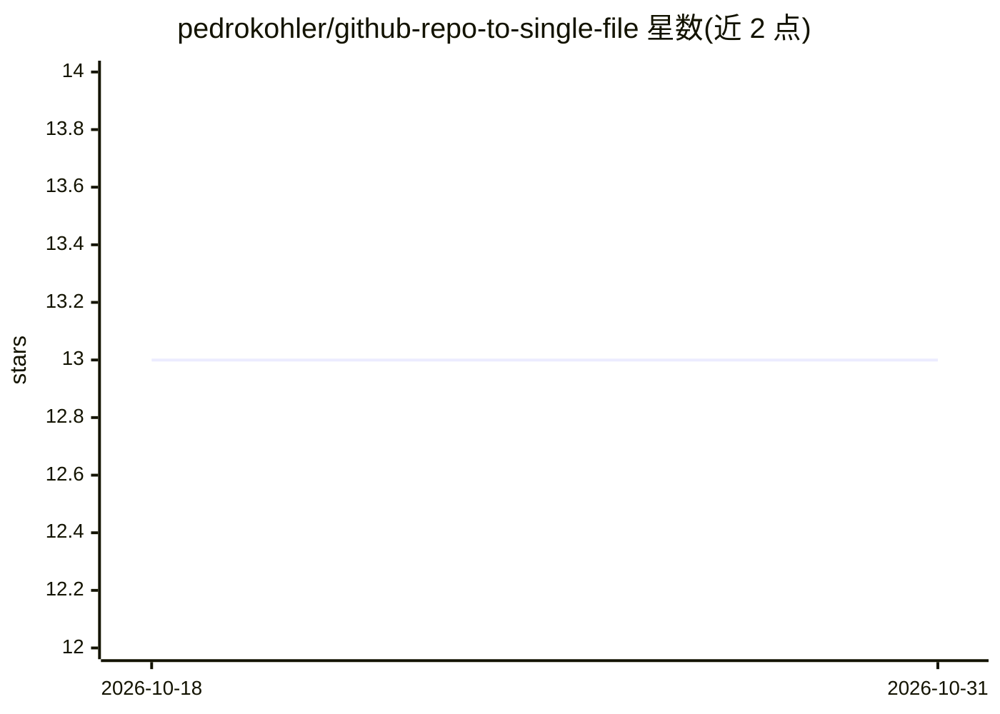

# pedrokohler/github-repo-to-single-file

⭐ 13 · TypeScript · 推送 2025-12-12 · [GitHub](https://github.com/pedrokohler/github-repo-to-single-file) · 个人维护

**把 GitHub 仓库或本地目录合并为单个 .txt/.pdf 的 CLI**

TypeScript 命令行工具，拉取 GitHub 仓库或扫描本地目录，将所有类文本文件合并为单一 .txt 或 .pdf 文件，输出到 out/ 目录。处理 GitHub 仓库需 Node.js 18+ 与 repo 权限的 personal access token，本地目录无需 token。机制上跳过二进制、媒体、锁文件与常见构建目录（node_modules/dist 等），流式显示进度，支持检查点断点续传，GitHub 限额前提示并可配置并发数（默认 8）。产物面向 LLM/RAG 场景，把整个代码库作为单一份输入。

## 筛选速览

| 维度 | 判定 | 备注 |
|---|---|---|
| AI 角色 | `ai-ecosystem` | LLM/agent 周边工具 |
| 许可风险 | `none` | — |
| 部署形态 | `library` | 以包/库形式分发 |
| 模型依赖 | — | README 未给出锁定关系 |
| 硬件要求 | — | 无带数字的原话,不猜 |
| 安装摩擦 | `low` | 无编译、无系统依赖或容器化 |
| 成熟度 | — | 结构信号不足 |

## 能力要点

- 合并仓库全部类文本文件为单个 .txt 或 .pdf
- 本地目录无需 GitHub token，自动排除隐藏文件与构建目录
- 检查点缓存支持断点续传，仅处理缺失文件
- 跳过 >5MB 大文件与媒体/压缩/锁文件，输出头部记录来源信息

## 适用场景

- 把整个代码库打包成单文件喂给 LLM 或 RAG 流程
- 将本地项目导出为一份可追溯的代码文档
- 在不触发 GitHub 限额的前提下导出指定分支代码

## 场景标签

 · 领域:开发者工具/LLM 上下文准备

## 证据(README 行号)

> L3: A TypeScript CLI that processes a GitHub repository or local directory and concatenates all text-like files into one
> L108:  - Files are read directly from disk with no API rate limits.

## 星数曲线

2026-10-18 13 → 2026-10-31 13（+0）

---
*卡片 v1 · prompt 1.4 · 生成 2026-10-31 · 置信度 high · 依据 README sha `1e231838f4f7` · [字段定义](../../DATASET.md)*
