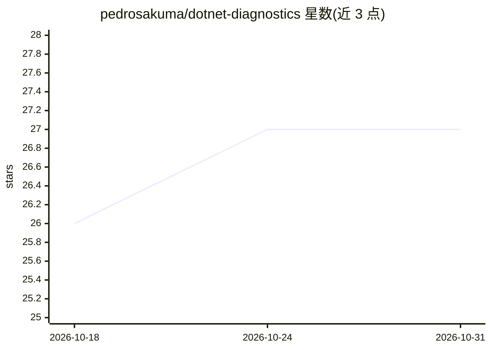

# pedrosakuma/dotnet-diagnostics

⭐ 27 · C# · MIT · 推送 2026-10-30 · [GitHub](https://github.com/pedrosakuma/dotnet-diagnostics) · 个人维护

**面向 .NET 应用的 LLM 驱动性能诊断 MCP 服务器**

在共用一套核心诊断引擎之上发布三个 NuGet 包：MCP 服务器（17 个工具，供 LLM 通过 HTTP+Bearer 或 stdio 驱动）、独立 CLI（含 stateful session REPL）与 BenchmarkDotNet 诊断器。通过 EventPipe 与 ClrMD 对运行中的 CoreCLR 进程（主要 .NET 10，8/9 官方支持）做计数器、CPU/off-CPU/分配采样、堆与线程快照、GC/争用/线程池事件采集，无需目标代码改动；例外是安全门控的 method-params 采集需动态附加。支持持久化证据（SQLite）与 Kubernetes sidecar 部署。

## 筛选速览

| 维度 | 判定 | 备注 |
|---|---|---|
| AI 角色 | `ai-ecosystem` | LLM/agent 周边工具 |
| 许可风险 | `permissive` | MIT |
| 部署形态 | `desktop` | 安装包/桌面程序 |
| 模型依赖 | — | README 未给出锁定关系 |
| 硬件要求 | — | 无带数字的原话,不猜 |
| 安装摩擦 | `low` | 无编译、无系统依赖或容器化 |
| 成熟度 | — | 结构信号不足 |

## 能力要点

- 同一引擎提供 MCP 服务器、独立 CLI、BenchmarkDotNet 诊断器三种分发
- 17 个统一工具覆盖事件采集、堆检查、线程快照、调查计划等
- HTTP+TLS/Bearer/OIDC 认证与 stdio 本地模式，非回环明文 HTTP 默认拒绝
- CLI 提供 per-OS 自包含二进制 Release 与 doctor 自检命令

## 适用场景

- 让 LLM 通过 MCP 客户端对 .NET 应用做性能排查
- 在 CI/脚本/kubectl 中用 CLI 采集进程诊断数据
- 为 BenchmarkDotNet 基准附加诊断以定位慢与高分配原因

## 场景标签

 · 领域:开发工具/性能诊断

## 证据(README 行号)

> L5: An **MCP server** for LLM-driven performance diagnostics on **.NET applications** — primarily
> L24: |**`dotnet-diagnostics-mcp`**|An **LLM**, via an MCP client|MCP tools over HTTP (bearer) or stdio|this README + `do

## 星数曲线

2026-10-18 26 → 2026-10-31 27（+1）

---
*卡片 v1 · prompt 1.4 · 生成 2026-10-26 · 置信度 high · 依据 README sha `76dabafd7bcd` · [字段定义](../../DATASET.md)*
