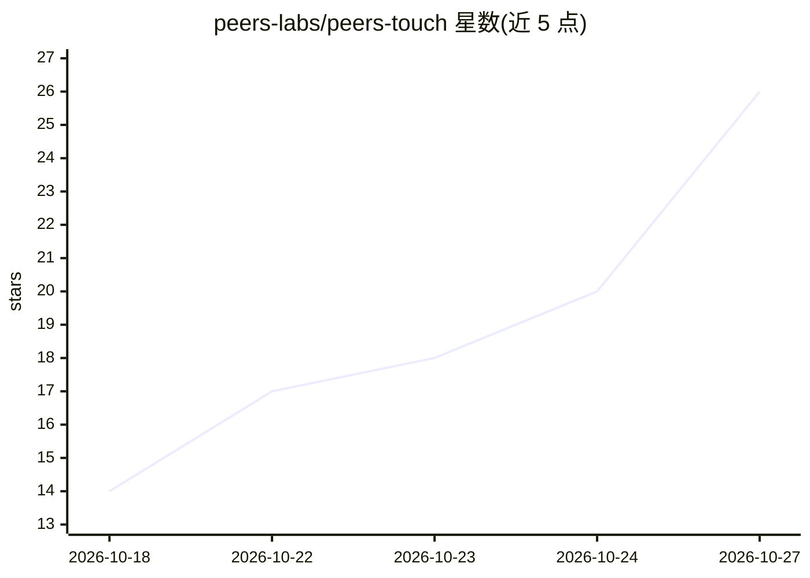

# peers-labs/peers-touch

⭐ 26 · TypeScript · MIT · 推送 2026-10-26 · [GitHub](https://github.com/peers-labs/peers-touch) · [官网](https://peers-touch.vercel.app) · 组织维护

**去中心化 P2P 社交网络，含个人 AI 助手与自托管 Station**

自托管、点对点的社交网络服务：每个用户运行或加入一个 Station（部署于 NAS、树莓派或云虚拟机的个人服务器），持有自己的身份、联系人、消息与内容；Station 间通过开放协议互联形成联邦网络，类比电子邮件的跨站通信。功能含端到端加密聊天、好友动态（Moments）、跨站加好友、Applet 扩展，以及可选模型与权限规则的个人 AI 助手。macOS 桌面端与 Android/iOS 应用（开发中），语音视频通话与端到端加密尚在开发，下载链接未发布。开发者需以 Go+PostgreSQL+Docker 从源码构建运行。

## 筛选速览

| 维度 | 判定 | 备注 |
|---|---|---|
| AI 角色 | `ai-enhanced` | 去掉 AI 部分产品仍成立 |
| 许可风险 | `permissive` | MIT |
| 部署形态 | `None` |  |
| 模型依赖 | — | README 未给出锁定关系 |
| 硬件要求 | — | 无带数字的原话,不猜 |
| 安装摩擦 | `low` | 无编译、无系统依赖或容器化 |
| 成熟度 | `idea` | |

## 能力要点

- Station 个人服务器模式，社交数据由用户持有
- Station 间通过开放协议联邦互联（libp2p 身份）
- 个人 AI 助手：可选模型、工具、上下文与权限设置
- 支持在 Station 上安装 Applet 扩展

## 适用场景

- 在自有设备上搭建社交空间，掌控自己的社交数据
- 与运行在不同 Station 上的好友跨站聊天与分享动态
- 在自己设备与数据上运行可定制模型与规则的个人 AI 助手

## 场景标签

 · 领域:社交网络/去中心化应用

## 证据(README 行号)

> L3: **Chat, share, and stay connected — on a social network nobody else controls.**
> L15: Agent — Personal AI assistant with tools, context, and permissions
> L23: - **Ask your AI** — an assistant on your devices and your data. Pick your model, set the rules.

## 星数曲线

2026-10-18 14 → 2026-10-27 26（+12）

---
*卡片 v1 · prompt 1.4 · 生成 2026-10-27 · 置信度 high · 依据 README sha `b8c1d0c06a0b` · [字段定义](../../DATASET.md)*
