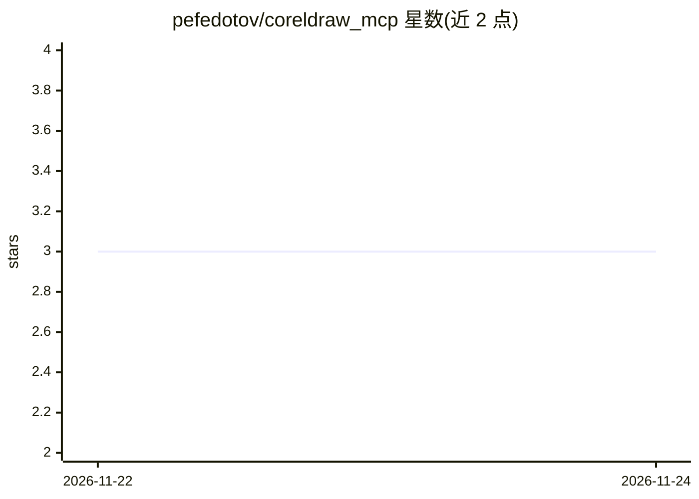

# pefedotov/coreldraw_mcp

⭐ 4 · C# · MIT · 推送 2026-10-19 · [GitHub](https://github.com/pefedotov/coreldraw_mcp) · 个人维护

**把运行中的 CorelDRAW 变成 MCP 服务器的插件**

以 CorelDRAW Graphics Suite 进程内插件形式提供的 MCP 服务器：通过 VGCore COM 接口驱动应用对象模型，向 MCP 客户端暴露文档、图形、文本、填充、变换、布尔运算、效果、图层与导出等工具组，AI 代理据此在用户已打开的文档中执行绘制指令，操作进入 CorelDRAW 原生撤销历史。支持 Claude Desktop、Cursor 等客户端经回环 HTTP 连接，提供工具开关、Token 鉴权与路径白名单配置。仅支持 Windows 上的 CorelDRAW 2025/2026，安装需管理员权限，部分工具箱功能（如刻刀、智能绘图）无法编程驱动。

## 筛选速览

| 维度 | 判定 | 备注 |
|---|---|---|
| AI 角色 | `ai-ecosystem` | LLM/agent 周边工具 |
| 许可风险 | `permissive` | MIT |
| 部署形态 | `desktop` | 安装包/桌面程序 |
| 模型依赖 | — | README 未给出锁定关系 |
| 硬件要求 | — | 无带数字的原话,不猜 |
| 安装摩擦 | `medium` | 含编译或系统依赖之一 |
| 成熟度 | — | 结构信号不足 |

## 能力要点

- 进程内 MCP 服务器，经 VGCore COM 驱动 CorelDRAW 对象模型
- 工具组覆盖文档/图形/文本/填充/变换/布尔/效果/导出等能力
- 回环地址监听（127.0.0.1）并支持 AuthToken、AllowedRoots、DisabledTools 配置
- 提供 MSI 安装包及本地构建脚本（WiX/MSI）

## 适用场景

- 用自然语言让 AI 代理在打开的 CorelDRAW 文档中创建和编辑图形
- 批量为多页文档替换文本、转换转曲并导出 PNG/PDF/SVG/DXF
- 按需关闭不想让代理触碰的工具以控制操作范围

## 场景标签

`GUI 自动化` `图像视频处理` · 领域:效率与自动化

## 证据(README 行号)

> L8: This add-on turns a running CorelDRAW Graphics Suite into a **Model Context Protocol (MCP)
> L13: MCP client  ──HTTP(loopback)──▶  CorelDRAW.exe (add-on)  ──VGCore COM──▶  drawing
> L99: **For developers** — the add-on is a single `net48` assembly loaded into `CorelDRAW.exe`; the MCP

## 星数曲线

2026-11-22 3 → 2026-11-24 3（+0）

---
*卡片 v1 · prompt 1.4 · 生成 2026-11-22 · 置信度 high · 依据 README sha `b37bad1ea4a6` · [字段定义](../../DATASET.md)*
