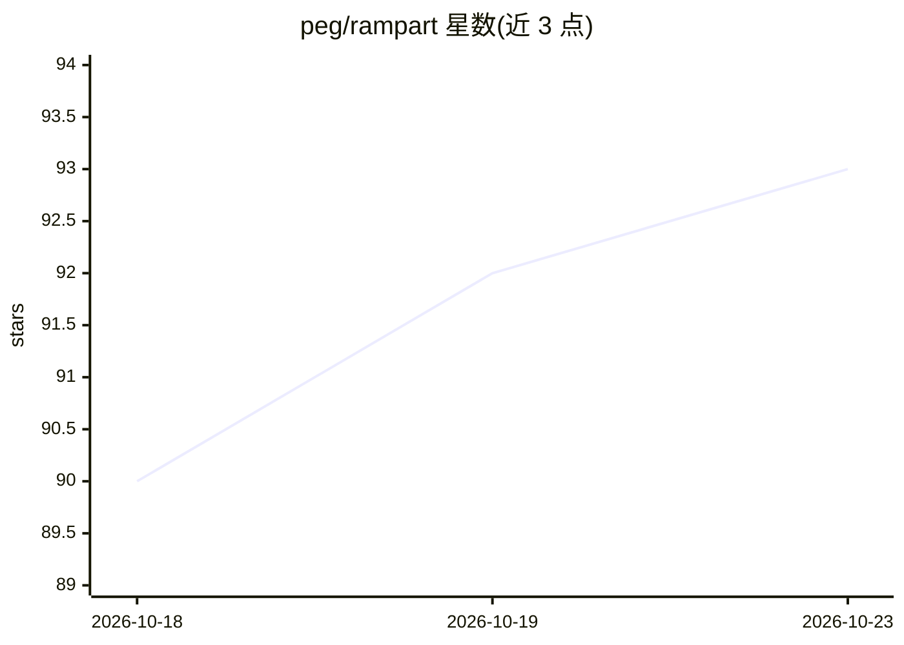

# peg/rampart

⭐ 93 · Go · Apache-2.0 · 推送 2026-10-20 · [GitHub](https://github.com/peg/rampart) · [官网](https://rampart.sh) · 组织维护

**给 AI agent 运维者的开源策略审批与审计防火墙**

面向操作 AI 编码代理（Claude Code、Codex、Cursor、OpenClaw 等）的开发者与运维人员，在其 hook/插件/代理/进程边界处评估动作并返回 allow/ask/deny，实施本地 YAML 策略（支持热重载与 CLI 快捷规则）。决策进入哈希链审计日志，敏感动作经人工审批队列处理。核心引擎为 Go 二进制，默认本地运行、无需 LLM 或厂商流量；明确定位为安全边界而非沙箱，不能观测已放行进程内的任意系统调用与网络流量。支持 brew、脚本安装器与 go install。

## 筛选速览

| 维度 | 判定 | 备注 |
|---|---|---|
| AI 角色 | `ai-ecosystem` | LLM/agent 周边工具 |
| 许可风险 | `permissive` | Apache-2.0 |
| 部署形态 | `library` | 以包/库形式分发 |
| 模型依赖 | — | README 未给出锁定关系 |
| 硬件要求 | — | 无带数字的原话,不猜 |
| 安装摩擦 | `low` | 无编译、无系统依赖或容器化 |
| 成熟度 | — | 结构信号不足 |

## 能力要点

- 在 10 类 agent 集成边界执行 allow/ask/deny 策略判定
- 哈希链审计日志，含凭据形状脱敏与审计校验命令
- 本地 YAML 策略热重载，核心执行与校验不依赖 LLM
- 对无原生 hook 的 agent 提供 wrap（shell 边界）与 preload（LD_PRELOAD）方式

## 适用场景

- 为多个 AI 编码工具统一配置操作策略与审批流程
- 审计 agent 在本机执行过的命令、文件与网络动作
- 拦截读取凭据文件或危险命令等敏感操作并转人工审批

## 场景标签

`网络安全` · 领域:学习与行业

## 证据(README 行号)

> L20: It sits at supported hooks, plugins, proxies, and process boundaries; evaluates
> L21: the action against local policy; and returns `allow`, `ask`, or `deny` before the
> L85: |**Local and model-free by default**|The policy engine is a Go binary. Core enforcement and verification do not req

## 星数曲线

2026-10-18 90 → 2026-10-23 93（+3）

---
*卡片 v1 · prompt 1.4 · 生成 2026-10-23 · 置信度 mid · 依据 README sha `d200062c4848` · [字段定义](../../DATASET.md)*
