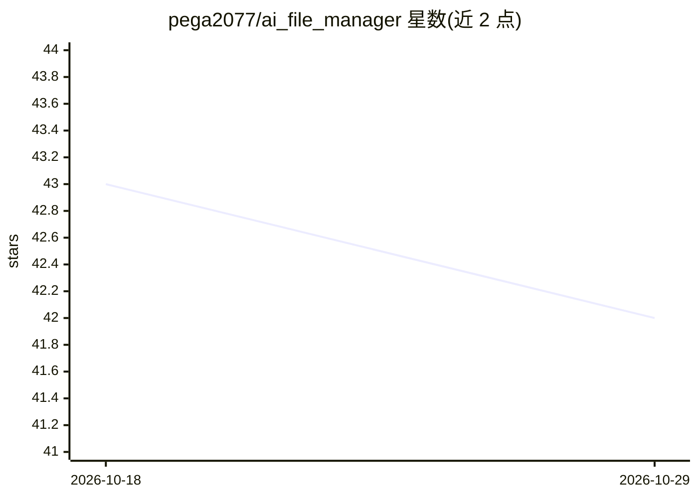

# pega2077/ai_file_manager

⭐ 42 · TypeScript · NOASSERTION · 推送 2026-03-04 · [GitHub](https://github.com/pega2077/ai_file_manager) · 个人维护 · 中文 README

**AI 驱动的本地文件管理器：自动分类打标、语义检索与 RAG 问答**

基于 Electron + React + TypeScript 的跨平台（Windows/macOS）桌面文件管理器。导入文档后自动转换为 Markdown、分类并打标，基于 Faiss 向量索引提供语义检索，并支持对文档内容的 RAG 问答（含答案来源追溯）。文档转换通过可配置的 fileConvertEndpoint 远程服务完成；元数据存于 SQLite。LLM/嵌入模型采用可插拔 Provider（OpenAI、Azure、OpenRouter、百炼、Ollama 等），数据存储在本地。README 声明项目仍在开发中。

## 筛选速览

| 维度 | 判定 | 备注 |
|---|---|---|
| AI 角色 | `ai-enhanced` | 去掉 AI 部分产品仍成立 |
| 许可风险 | `none` | NOASSERTION |
| 部署形态 | `None` |  |
| 模型依赖 | local-ok | 支持本地模型 |
| 硬件要求 | — | 无带数字的原话,不猜 |
| 安装摩擦 | `low` | 无编译、无系统依赖或容器化 |
| 成熟度 | `idea` | |

## 能力要点

- 导入文档自动分类、打标并生成摘要
- 基于 Faiss 向量索引的语义检索
- 文档内容 RAG 问答，答案可溯源
- 可插拔 LLM/嵌入 Provider（OpenAI、Azure、OpenRouter、百炼、Ollama 等）

## 适用场景

- 整理本地文档，自动归入合适文件夹并打上标签
- 用自然语言或关键词搜索自己的文档库
- 针对已导入文档做问答并获得来源引用

## 场景标签

`RAG` `语义搜索` `文档问答` · 领域:知识与检索

## 证据(README 行号)

> L3: A smart file manager powered by AI. It automatically classifies your imported files into the most suitable folders a
> L15: - 💬 **Intelligent Q&A** - Document content Q&A based on RAG technology
> L25: - **AI Models**: Pluggable LLM / embedding providers (OpenAI, Azure, OpenRouter, Bailian, Ollama, etc.)

## 星数曲线

2026-10-18 43 → 2026-10-29 42（-1）

---
*卡片 v1 · prompt 1.4 · 生成 2026-10-25 · 置信度 high · 依据 README sha `2ad06239705b` · [字段定义](../../DATASET.md)*
