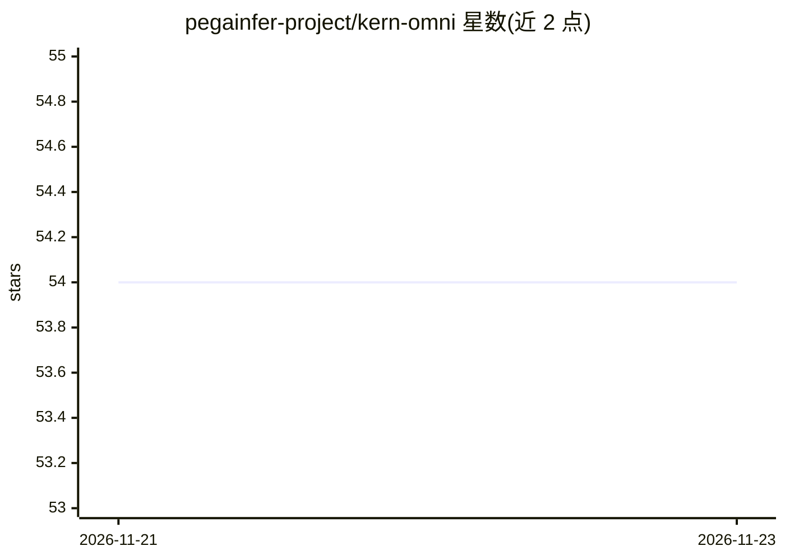

# pegainfer-project/kern-omni

⭐ 54 · Rust · 推送 2026-11-20 · [GitHub](https://github.com/pegainfer-project/kern-omni) · 组织维护

**Rust 实现的 OpenAI 兼容语音服务端：流式 TTS 与全双工实时会话**

pegainfer 项目的语音与图像推理服务端，以 Rust 编写，兼容 OpenAI API：提供 /v1/audio/speech 流式 TTS、GPT-Live WebSocket 全双工会话与 /v1/images/generations 文生图。内置四个 GPU 引擎（Qwen3-TTS、Higgs TTS 3、PersonaPlex-7B、HiDream-O1-Image）与 CPU 模拟引擎用于压测，全部会话合入单一 CUDA graph。通过 cargo 从源码构建，GPU 引擎构建需 CUDA 13.x 工具链。Apache-2.0 许可。

## 筛选速览

| 维度 | 判定 | 备注 |
|---|---|---|
| AI 角色 | `ai-ecosystem` | LLM/agent 周边工具 |
| 许可风险 | `none` | — |
| 部署形态 | `None` |  |
| 模型依赖 | — | README 未给出锁定关系 |
| 硬件要求 | — | 无带数字的原话,不猜 |
| 安装摩擦 | `high` | 编译与系统依赖俱全 |
| 成熟度 | — | 结构信号不足 |

## 能力要点

- OpenAI 兼容 API：/v1/audio/speech、GPT-Live WebSocket 会话、/v1/images/generations
- 全双工会话以 80 ms 帧时钟驱动，所有会话合入每 tick 一张 CUDA graph
- 内置 PersonaPlex 浏览器 demo（麦克风输入、语音与转写输出）
- Prometheus 指标（TTFP、端到端延迟、引擎队列）与 CPU 模拟引擎压测工具

## 适用场景

- 为已有 OpenAI 客户端替换语音合成与实时语音后端
- 部署低首包延迟的流式 TTS 服务
- 在单 GPU 上承载多路全双工实时语音会话
- 用模拟引擎与 omni-bench 对服务前端做负载测试

## 场景标签

`语音合成` `语音 Agent` `图像生成` `推理引擎` · 领域:对话与助手

## 证据(README 行号)

> L5:  OpenAI-compatible speech and image serving in Rust, from the pegainfer project.
> L18: session costs a frame per tick whether anyone talks. pega-omni serves them over
> L22: The repository holds the serving front end, the engine contracts, CPU-only

## 星数曲线

2026-11-21 54 → 2026-11-23 54（+0）

---
*卡片 v1 · prompt 1.4 · 生成 2026-11-21 · 置信度 high · 依据 README sha `ba414c6dcd5a` · [字段定义](../../DATASET.md)*
