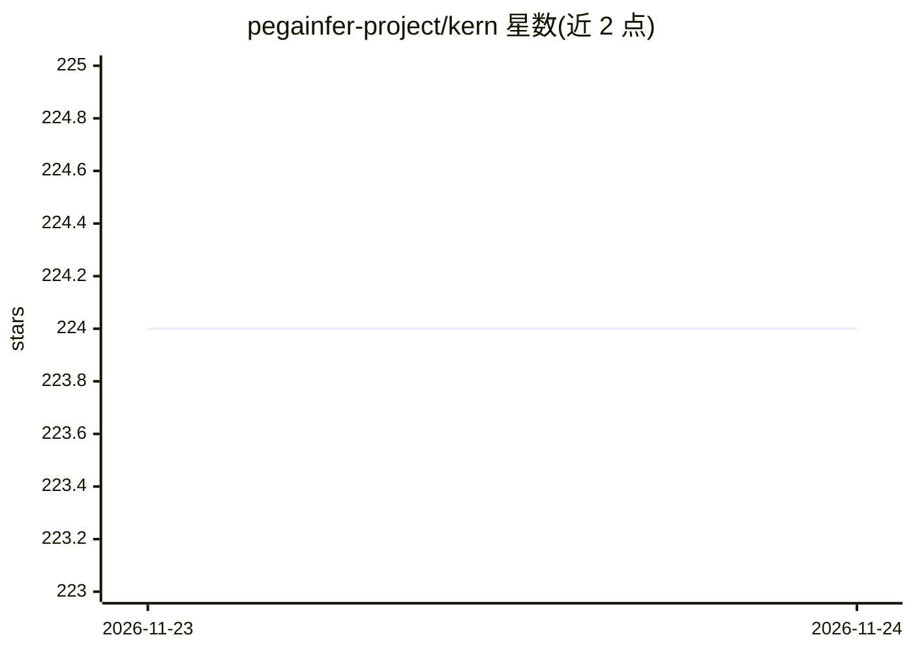

# pegainfer-project/kern

⭐ 235 · Rust · Apache-2.0 · 推送 2026-11-23 · [GitHub](https://github.com/pegainfer-project/kern) · [官网](https://kern-baa.pages.dev/) · 组织维护

**面向 agent 的 GPU LLM 推理运行时，模型以清单+内核交付**

用 Rust 编写的 model-agnostic GPU 推理运行时：模型以 manifest.json（类型化声明 buffers/ops/parallelism）、SHA-256 固定的编译内核与 Hugging Face 权重三件套打包，运行时不含模型代码。kern-serve 提供 continuous batching 与 OpenAI 兼容 API，也可作为模型层嵌入 vLLM/SGLang。带 kern test/bench/workload 工具做逐 span 复现与计时归因。定位是让 agent 通过编辑 manifest 快速更换内核、并行布局与模型。安装为单二进制或 cargo 源码构建。

## 筛选速览

| 维度 | 判定 | 备注 |
|---|---|---|
| AI 角色 | `ai-ecosystem` | LLM/agent 周边工具 |
| 许可风险 | `permissive` | Apache-2.0 |
| 部署形态 | `library` | 以包/库形式分发 |
| 模型依赖 | local-ok | 支持本地模型 |
| 硬件要求 | — | 无带数字的原话,不猜 |
| 安装摩擦 | `high` | 编译与系统依赖俱全 |
| 成熟度 | — | 结构信号不足 |

## 能力要点

- 模型打包为 manifest + CUDA 内核 + HF 权重，SHA-256 固定
- kern test 逐 span 复现对比，确定性输出（无时钟、无随机）
- kern-serve 提供 OpenAI 兼容 API、continuous batching 与前缀缓存
- 可嵌入 vLLM 与 SGLang，调度与缓存留在宿主，前向为 manifest

## 适用场景

- 让 AI agent 迭代优化推理引擎的内核与并行配置
- 以独立服务器方式提供 OpenAI 兼容的模型服务
- 在 vLLM/SGLang 中替换前向计算为清单化模型包
- 跨多 GPU/机架部署大模型并做流水线切分

## 场景标签

`推理引擎` · 领域:训练与推理

## 证据(README 行号)

> L44: kern splits engine from model. The engine contains no model and rarely
> L172: `kern-serve` is kern's own server: continuous batching, an OpenAI-compatible
> L174: pipeline stages across trays. kern also runs as the model inside vLLM or

## 星数曲线

2026-11-23 224 → 2026-11-24 224（+0）

---
*卡片 v1 · prompt 1.4 · 生成 2026-11-23 · 置信度 high · 依据 README sha `024e25ab1c5b` · [字段定义](../../DATASET.md)*
