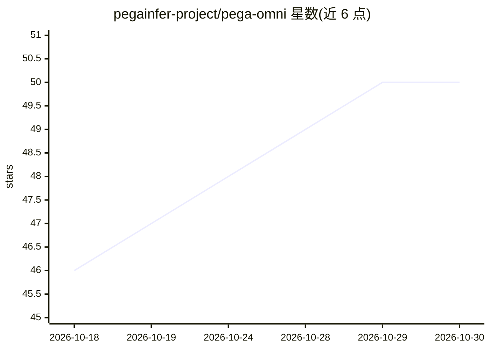

# pegainfer-project/pega-omni

⭐ 50 · Rust · 推送 2026-09-30 · [GitHub](https://github.com/pegainfer-project/pega-omni) · 组织维护

**Rust 编写的 OpenAI 兼容语音/图像推理服务，支持流式 TTS 与全双工语音**

pegainfer 项目的推理服务前端：以单一进程、单一引擎循环提供 OpenAI 兼容的 /v1/audio/speech、GPT-Live WebSocket 全双体会话与 /v1/images/generations 接口。仓库含引擎契约、CPU 模拟引擎（用于负载测试）和三个 GPU 引擎：Qwen3-TTS-12Hz-1.7B-CustomVoice（语音）、NVIDIA PersonaPlex-7B（全双工，官方称单张 GB300 可跑 128 个并发会话）、HiDream-O1-Image（文生图）。GPU 引擎需 CUDA toolkit 13.x 从源码编译，配 axum 前端、Prometheus 指标与浏览器实时演示页。

## 筛选速览

| 维度 | 判定 | 备注 |
|---|---|---|
| AI 角色 | `ai-ecosystem` | LLM/agent 周边工具 |
| 许可风险 | `none` | — |
| 部署形态 | `None` |  |
| 模型依赖 | local-ok | 支持本地模型 |
| 硬件要求 | `cpu-ok` | |
| 安装摩擦 | `high` | 编译与系统依赖俱全 |
| 成熟度 | — | 结构信号不足 |

## 能力要点

- 流式 TTS / GPT-Live 全双工 / 图像生成三类 OpenAI 兼容接口
- 三个 GPU 引擎：Qwen3-TTS、PersonaPlex-7B、HiDream-O1-Image
- CPU 模拟引擎可用于无 GPU 的前端负载测试
- Prometheus 指标与自带压测工具 omni-bench（TTFP/E2E/RTF/播放欠载）

## 适用场景

- 为应用提供 OpenAI 兼容的流式 TTS 服务
- 部署全双工语音会话并经浏览器页面试用
- 在单卡上并发运行多个实时语音会话

## 场景标签

`语音合成` `语音 Agent` `图像生成` `推理引擎` · 领域:对话与助手

## 证据(README 行号)

> L5:  OpenAI-compatible speech and image serving in Rust, from the pegainfer project.
> L22: The repository holds the serving front end, the engine contracts, CPU-only
> L23: simulated engines used to load-test the front end, and three GPU engines:

## 星数曲线

2026-10-18 46 → 2026-10-30 50（+4）

---
*卡片 v1 · prompt 1.4 · 生成 2026-10-25 · 置信度 high · 依据 README sha `bda17d0a0118` · [字段定义](../../DATASET.md)*
