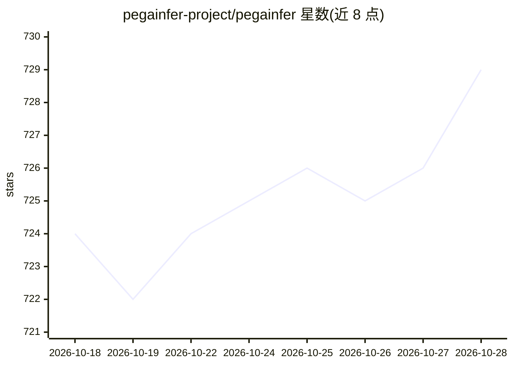

# pegainfer-project/pegainfer

⭐ 729 · Rust · Apache-2.0 · 推送 2026-10-28 · [GitHub](https://github.com/pegainfer-project/pegainfer) · [官网](https://pegainfer.org/) · 组织维护

**纯 Rust+CUDA 的 LLM 推理引擎，OpenAI 兼容 API 服务多种模型**

用 Rust 编写、不依赖 PyTorch 的 LLM 推理引擎：以 OpenAI 兼容 API（8000 端口，支持流式 completions 与 chat/completions）对外服务。架构上各模型拥有独立调度器、状态与内核，GPU 加载、采样与 KV 基础设施共享；前端复用 vLLM 的 Rust frontend crates。默认仅启用 Qwen3，其他模型线（Qwen3.5、Gemma 4、DeepSeek-V2-Lite、Kimi-K2/K3、GLM-5.2）通过 cargo feature 开启，能力与成熟度因模型而异，部分处于 bring-up 阶段。提供 Linux x86_64 预编译安装脚本与源码编译路径，需 NVIDIA GPU（算力 8.x–12.x、驱动 580+）。

## 筛选速览

| 维度 | 判定 | 备注 |
|---|---|---|
| AI 角色 | `ai-ecosystem` | LLM/agent 周边工具 |
| 许可风险 | `permissive` | Apache-2.0 |
| 部署形态 | `library` | 以包/库形式分发 |
| 模型依赖 | locked-api |  |
| 硬件要求 | — | 无带数字的原话,不猜 |
| 安装摩擦 | `medium` | 含编译或系统依赖之一 |
| 成熟度 | — | 结构信号不足 |

## 能力要点

- 无 PyTorch/Python 运行时的 Rust+CUDA 推理引擎
- OpenAI 兼容 API，/v1/completions 与 /v1/chat/completions 均支持流式
- 各模型独立调度器与内核，共享 GPU/采样/KV 基础设施
- 支持 Qwen3/Qwen3.5/Gemma 4/DeepSeek-V2-Lite/Kimi-K2/Kimi-K3/GLM-5.2 等模型线

## 适用场景

- 用 OpenAI 兼容客户端对接自托管 LLM 服务
- 在生产环境以单进程低内存占用服务 Qwen3 等模型
- 多 GPU 上运行 MoE 模型（Kimi-K2 8 卡专家并行等）

## 场景标签

`推理引擎` · 领域:训练与推理

## 证据(README 行号)

> L20: PegaInfer serves LLMs through an OpenAI-compatible API. Each model owns its scheduler, state, and kernels; serving 
> L142: |`pegainfer-frontend`|OpenAI protocol, tokenization, chat templates, streaming, metrics, and engine contracts; use

## 星数曲线

2026-10-18 724 → 2026-10-28 729（+5）

---
*卡片 v1 · prompt 1.4 · 生成 2026-10-21 · 置信度 mid · 依据 README sha `2844cf4a77a0` · [字段定义](../../DATASET.md)*
